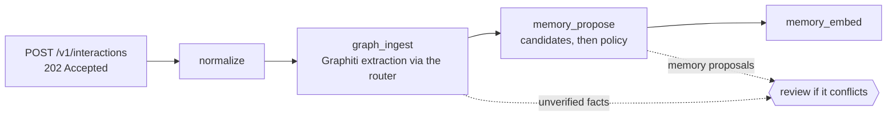

import TapeCall from "../../../../components/TapeCall.astro";

There are two write paths, and the difference between them is the most important thing to understand about what the platform will *believe*.

| | **Commands** | **Interactions (extraction)** |
|---|---|---|
| From | A trusted system of record (HR, CRM, your app) | A conversation, document, observation |
| Endpoint | `POST /v1/entities`, `/v1/relationships` | `POST /v1/interactions` |
| Model involved | **Never** | Yes, through the router |
| Result | Verified fact, `authoritative_system` | **Unverified** proposal, `conversation_report` |
| Validation | The published ontology and its rules, immediately | Policy, identity resolution, conflict policy, then review |
| Idempotency | `Idempotency-Key`: same key and body is one write | `Idempotency-Key`: same key and body is one event; a different body is a 409 |

## Commands

A command is validated against the published ontology's rules (`require_source`, `preserve_valid_time`, `succession`, ...), recorded in the command ledger and projected deterministically. Because no model runs, the same input always produces the same graph. In the Sarah scenario, six writes make zero model calls:

<TapeCall tape="sarah" step="2" path="/v1/entities" method="POST" nth={0} />

A rejected or queued command is recorded under its `Idempotency-Key`; a corrected retry needs a **new** key.

## Interactions and the pipeline

An interaction is written to an encrypted ledger row and an outbox row in **one transaction**, and answered `202`. Workers then run the stages:

<TapeCall tape="sarah" step="3" path="/v1/interactions" method="POST" nth={0} pick={["event_id","status","status_url"]} note="Accepted, not done. Poll the status URL, or watch it on the write-path playground." />

- **Extracted knowledge starts unverified.** What the model finds is labelled, and policy decides what activates: episodic and semantic memories may activate on their own, procedural ones never do without a person.
- **A model cannot overwrite a verified fact.** A conflict with a higher-authority fact becomes a proposal plus a `contradiction` review item, and Graphiti's own invalidation is reverted.
- **Failures never lose an event.** Stages are leased and retried with backoff, then dead-lettered; a crash before the stage commits asks the model again and a content hash keeps one result.
- **The gate comes first.** Consent, egress policy, classification and the workspace's extraction setting are checked before any call; a denied event makes zero model calls.

## Which should I use?

If something owns the truth about a thing (your HR system for who works where), write it as a **command**. If knowledge lives in free text (a meeting note, a chat), send an **interaction** and let it arrive as a labelled proposal. Many deployments use both, as the Sarah scenario does.

## See it, run it, configure it

- **See it:** the [write-path playground](/see-it/write-path/) and Sarah steps 2 and 3.
- **Run it:** notebook 01; the [ingest-a-source tutorial](/docs/tutorials/ingest-a-source/).
- **Configure it:** the memory policy and rules in the [ontology](/docs/concepts/ontology/); the [rule catalog](/docs/reference/rule-catalog/).
- **Decisions:** [ADR-016](/docs/reference/adrs/adr-016-deterministic-write-path/), [ADR-024](/docs/reference/adrs/adr-024-interaction-ledger-idempotency-and-encryption/), [ADR-025](/docs/reference/adrs/adr-025-outbox-and-effectively-once/), [ADR-030](/docs/reference/adrs/adr-030-memory-extraction-policy-and-prompt-safety/).
