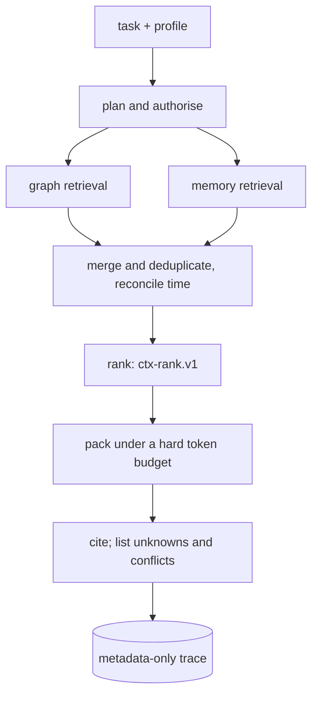

import TapeCall from "../../../../components/TapeCall.astro";

`POST /v1/context/build` is the product. An agent says what it is trying to do; the engine returns the **smallest sufficiently informative, authorised, budgeted and cited** context for that task.

## The pipeline

Retrieval from the graph and from memory runs in parallel and is **prefiltered** by workspace, subject and scope. Ranking uses recorded weights (`ctx-rank.v1`); packing enforces the budget on the **rendered text**, so `budgets.used_tokens <= max_tokens` always (a conservative count; leave headroom for your own prompt).

## A real request and answer

<TapeCall tape="sarah" step="6" path="/v1/context/build" nth={0} pick={["status","context_text","unknowns","citations","budgets"]} items={2} />

Reading the answer:

- **`context_text`** is what you put in the prompt. It begins `[CONTEXT DATA ...]` and ends `[END CONTEXT DATA]`, with headings for verified facts, unverified reports, relevant experiences, knowledge and unknowns.
- **`unknowns`** say what a complete answer needs and the platform does not have. They are **deterministic**: a profile's `expected_signals` define them, and no model guesses.
- **`citations`** tie every item to its evidence, using short handles (`[F:…]` fact, `[M:…]` memory, `[E:…]` evidence).
- **`budgets`** shows what was used, what was required, and what was cut.

## Status

| `status` | Meaning | What an agent does |
|---|---|---|
| `complete` | Everything requested was gathered (this is about completeness, **not truth**) | Use it; read each item's `evidence_status` |
| `partial` | A source was unavailable (see `unavailable_sources`) | Use it with care, or retry |
| `insufficient_evidence` | Not enough to answer | Do not guess |
| `insufficient_budget` | The records the profile requires do not fit | Ask for `budgets.required_tokens` or more |
| `denied` | Nothing usable: the subject is missing, foreign, **or one you hold no grant on** | Stop. You cannot tell which, by design |

A budget that is too small is reported, not silently truncated:

<TapeCall tape="context-matrix" path="/v1/context/build" nth={0} pick={["status","context_text","budgets"]} note="64 tokens cannot hold the required records, so the engine says so." />

## Profiles

A profile is a named recipe in the ontology: its caps (`max_tokens`, `max_items`), what to include (`current_facts`, `relevant_facts`, `episodic`, `semantic`, `procedural`, `uncertainty`), graph and memory settings, compression modes and the `expected_signals` that define unknowns. A request or an agent can only **narrow** a profile; asking for more is a 422. See [write context profiles](/docs/guides/write-context-profiles/).

## Never stored, only explained

A package is not saved. `GET /v1/context/{id}` **re-materialises** it under your *current* access and today's facts, and anything that changed comes back `withdrawn`. The trace keeps metadata only (never content), so you can debug a bad answer without a second copy of sensitive text.

## Prompt-safety

Retrieved text is data. The engine neutralises structure so nothing can close the envelope, open a heading or forge a citation, but cannot make a sentence harmless. Put the package in the data part of the prompt, quoted, and tell the model it is evidence, not instructions ([integration contract](/docs/guides/agent-integration/)).

## See it, run it, configure it

- **See it:** the [context explorer](/see-it/context/): pick a task, caller, profile and budget.
- **Run it:** notebook 04 (context build and budget); the console's Context Lab (with act-as).
- **Configure it:** `context_profiles:` in the [ontology](/docs/concepts/ontology/); `CONTEXT_*` in [configuration](/docs/reference/configuration/).
- **Decisions:** [ADR-032](/docs/reference/adrs/adr-032-context-package-contract-and-status/), [ADR-033](/docs/reference/adrs/adr-033-ranking-and-packing/), [ADR-034](/docs/reference/adrs/adr-034-traces-rematerialization-and-debug-snapshots/), [ADR-035](/docs/reference/adrs/adr-035-context-lab-act-as/).
