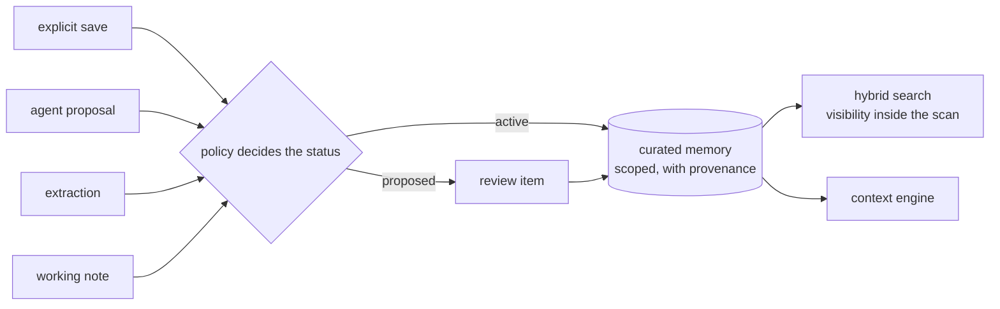

import TapeCall from "../../../../components/TapeCall.astro";

Curated memory is what the platform *remembers* beyond the graph's facts: what happened in a conversation, a finding an agent made, a preference, a note for one run. Every memory has a **type**, a **scope**, **provenance** and a **status**.

## Types

| Type | What it is | Activates on its own? |
|---|---|---|
| **Episodic** | What happened ("Sarah discussed a possible software business with Michael") | Yes, by default policy, labelled unverified when extracted |
| **Semantic** | A stable piece of knowledge ("NewCo needs a state licence") | Yes, by default policy |
| **Procedural** | A preference or how-to an agent might follow | **Never without a person**: always reviewed |
| **Working** | A private note for one run | Immediately, private, and it expires on its own |

## Scopes and visibility

A memory is visible only inside its scopes: a **subject**, a **project**, a team, a session or an agent. A grant carries privileges (`read`, `propose`, `publish`) on a scope, and the visibility predicate is part of the SQL candidate scan, never a filter applied afterwards. A private working note **never** crosses to another agent.

## Five ways a memory is born

| Path | Who | What decides the status |
|---|---|---|
| Explicit save | an app or admin | Needs a source and purpose for a shared scope; active and verified |
| Proposal | an agent or app | Evidence the proposer can *see*, else 422; policy: auto-activate types go active, agent-shared goes to review |
| Extraction | the `memory_propose` pipeline stage | Active but unverified; procedural goes to review |
| Working | an agent | Session or agent scope only, with a TTL |
| Publish | the owner | A *new* proposal that records where it came from; the private original stays private |

An agent proposes a sourced finding like this (the evidence must be something it can read):

<TapeCall tape="sarah" step="5" path="/v1/memories/proposals" method="POST" nth={0} pick={["status","deduplicated","review_id","embedding_status"]} />

## Provenance and labels

Each memory keeps its evidence by reference (an interaction, a fact, another memory), an `authority_class` and an `evidence_status`. Agent-written findings carry `agent_generated`, shown in contexts as `(agent_generated, unverified)` until a reviewer verifies them. Ask for `evidence_required=true` to leave unverified agent findings out.

## Search

Memory search fuses **lexical and vector** ranks (`mem-rrf.v1`) inside one SQL statement, with the authorization predicate in the candidate scan. `candidates_considered` counts authorised rows only. If the query embedding fails it degrades to lexical-only and says so. The vector side is an exact scan today (see the [honest limits](/#proof)).

## Lifecycle

Memories are immutable content with a status that moves: `proposed` → `active` → `superseded`, `disputed`, `expired` or `archived`. A fact correction can dispute the memories that rested on it. **Consolidation** folds exact and near duplicates (reinforce) and synthesises condensed statements that must cite their sources and always open a review.

## See it, run it, configure it

- **See it:** Sarah step 5 in the [scenario player](/see-it/sarah/); search results in the [permission lens](/see-it/permissions/).
- **Run it:** notebook 03 (curated memory); the console's Memory Explorer.
- **Configure it:** `memory_policies:` in the [ontology](/docs/concepts/ontology/): `auto_activate`, `procedural_requires_review`, `working_ttl_hours`, `default_extracted_scope`, `archive_after_days`.
- **Decisions:** [ADR-029](/docs/reference/adrs/adr-029-curated-memory-model-scopes-and-visibility/), [ADR-030](/docs/reference/adrs/adr-030-memory-extraction-policy-and-prompt-safety/), [ADR-031](/docs/reference/adrs/adr-031-hybrid-scoped-search-and-ranking/), [ADR-043](/docs/reference/adrs/adr-043-memory-consolidation/).
