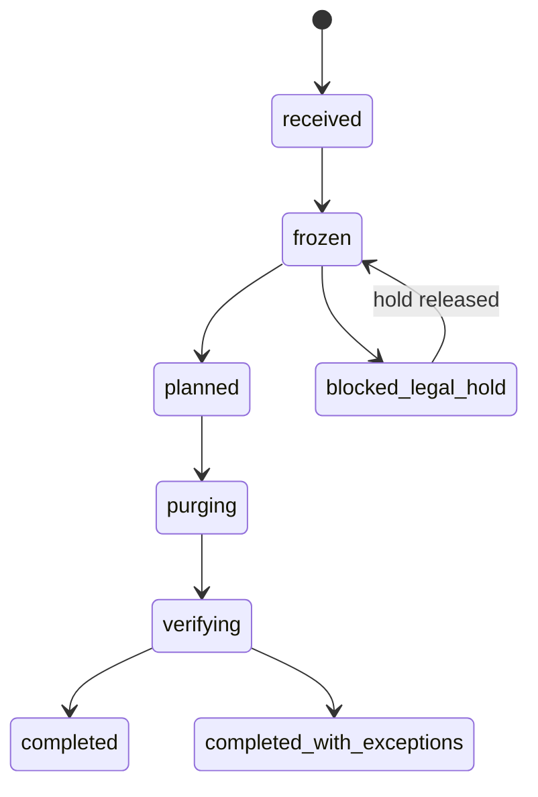

import TapeCall from "../../../../components/TapeCall.astro";

The platform assumes it will be wrong sometimes and be asked to forget. Governance is how both are handled without hand-editing databases.

## Corrections

A correction is an **audited ledger command** (reject, supersede, end, restore a fact; correct an attribute; rename; correct a memory; split an entity). It needs an `If-Match` on the record's revision, an `Idempotency-Key` and a reason **code**, and it has a **preview** that counts what it would change: graph operations, predecessor facts that would reopen, dependent memories, open reviews and recent contexts.

Postgres is authoritative and the graph follows by projection; contexts re-materialise, so the next one reflects the correction at once. Evidence is never rewritten: a correction appends. In Sarah step 9 a wrongly extracted fact is rejected and disappears from the next context while the original message stays on record:

<TapeCall tape="sarah" step="9" path="/corrections" method="POST" nth={0} />

Shared memories that rested on a rejected fact become `disputed` with a review item, and a restore reverses it. A correction is a person's decision, so it is not ranked against the source's authority; if it overrides an authoritative system, an `authoritative_override` review tells that source's owner.

## Deletion with a receipt

1. **Freeze.** In the request's own transaction, the subject's records become `deletion_pending`: every read, projection and job treats them as absent from that commit. Reads stop immediately.
2. **Plan.** Every derivative is listed by store: Postgres, the vector index, the graph, traces, jobs, idempotency records. Memories that merely *name* the subject become `deletion_exception` reviews instead of being deleted.
3. **Purge.** Fixed per-store steps, each idempotent. The database itself enforces the plan: a trigger allows a delete or redaction only for rows listed in a purging request, so a bug cannot delete outside it.
4. **Verify.** Id scans over every store and residual-text scans for the manifest's names and identifiers. Any residual becomes an exception.
5. **Receipt.** Counts per store, what was kept and why, the verification result and when backup copies expire.

<TapeCall tape="sarah" step="10" path="/v1/deletion-requests/" method="GET" nth={-1} pick={["status","receipt"]} items={6} />

What stays, and the receipt says so: the ledger keeps its rows with payloads redacted to a hash marker, `audit_log` is never altered (ids and codes only), and a **suppression** (an HMAC of each strong identifier) refuses re-creation of the subject until an admin lifts it. A **deletion journal** kept outside the database and its backups makes a restored backup forget again.

## Legal holds and retention

A **legal hold** (subject, interaction or workspace) freezes records but does not purge; releasing resumes the request. Retention is configurable per workspace through versioned **workspace settings** (with history), including what may be sent to a model (the egress policy). Workspace deletion suspends the workspace at once and waits out a cooling-off period (`WORKSPACE_DELETION_COOLING_HOURS`, 24 by default).

## Audit

Every mutation writes an append-only `audit_log` entry with closed metadata (codes and ids, never content). The **privacy audit** timeline in the console shows who did what to a subject.

## Ontology simulation

Before publishing a new ontology you can **simulate** it: the draft runs in an isolated staging namespace in the graph and the report says what would change and what it would cost, leaving nothing behind.

## See it, run it, configure it

- **See it:** Sarah steps 9 and 10 in the [scenario player](/see-it/sarah/).
- **Run it:** notebook 06 (corrections and deletion); the console's Deletions and Privacy audit screens.
- **Operate it:** [subject-deletion](/docs/operations/subject-deletion/), [legal-hold](/docs/operations/legal-hold/), [retention](/docs/operations/retention/), [ontology-simulation](/docs/operations/ontology-simulation/).
- **Decisions:** [ADR-041](/docs/reference/adrs/adr-041-corrections-and-authoritative-overrides/), [ADR-044](/docs/reference/adrs/adr-044-deletion-lifecycle-purge-gate-and-verification/), [ADR-045](/docs/reference/adrs/adr-045-suppression-tombstones-and-the-deletion-journal/), [ADR-047](/docs/reference/adrs/adr-047-workspace-settings-and-retention/).
