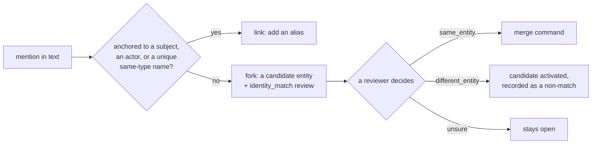

A name is not an identity. "Michael" in a conversation might be the Michael in your HR system, or a different one, and guessing wrong would merge two people's facts.

## The flow

- **Deterministic identity** comes only from declared external identifiers (for example an `E-1001` from your HR system) that the entity type allows. Names never match deterministically.
- **Linking** happens when a mention is anchored: the conversation already names the subject, or a name variant matches a unique same-type subject.
- **Everything else forks** into a *candidate* entity and an `identity_match` review. Facts about a candidate are `proposed` (`identity_pending`) until a person decides.

## Review items

Review items are how the platform asks a person. Types include `contradiction` (an extracted fact conflicts with a higher-authority one), `identity_match`, `policy_violation` (out of the ontology or over its authority), `memory_proposal`, `memory_conflict`, `consolidation_proposal` and `deletion_exception`. A decision is a ledger command (`review.decide`) with `If-Match` and an `Idempotency-Key`; the rationale code is a closed set and free text stays on the review row, never in the audit log.

## Merge and split

A merge combines two entities; a **split** is its compensating command. A split moves chosen mentions, identifiers, facts and memories to a new entity, records the pair as a non-match so they are not merged again, and can replay the conversations it moved. Both preview their impact first.

## The conflict policy

When an extracted fact meets an existing one, a fixed, table-tested policy decides: nothing on the same relationship is `active` and unverified; the same fact with the same authority adds evidence; a cardinality conflict with a verified fact becomes `proposed` plus a `contradiction` review; a clean succession in time from a verified source ends the old fact with no review; and a type or endpoint outside the ontology is rejected but kept for audit.

## See it, run it, configure it

- **See it:** Sarah step 9: a wrongly extracted "Michael manages Sarah" is rejected and disappears from the next context.
- **Run it:** the console's Review Queue; notebook 06 (corrections and deletion).
- **Configure it:** `identity:` per entity type in the [ontology](/docs/concepts/ontology/).
- **Decisions:** [ADR-027](/docs/reference/adrs/adr-027-reconcile-then-restore-and-authority/), [ADR-028](/docs/reference/adrs/adr-028-identity-resolution-and-merge/), [ADR-042](/docs/reference/adrs/adr-042-identity-split/). Runbook: [identity-correction](/docs/operations/identity-correction/).
