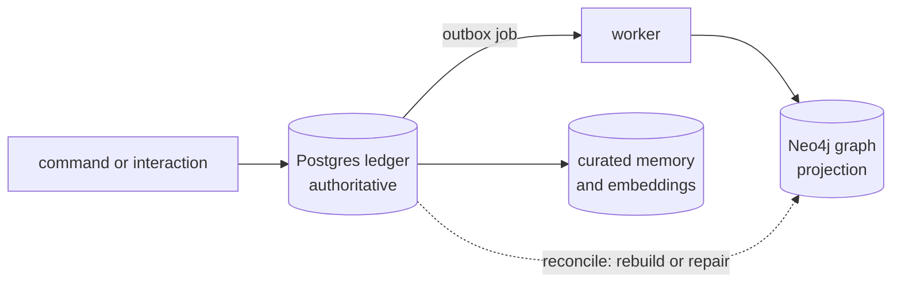

import TapeCall from "../../../../components/TapeCall.astro";

**Postgres holds the truth. The graph is a projection of it.** This is the central design choice, and most of the platform's guarantees follow from it.

## What lives where

| Postgres (authoritative) | Neo4j with Graphiti (projection) |
|---|---|
| The command ledger and the interaction ledger | Entities and relationships as a graph |
| Facts, entities, evidence, identity decisions | Episodes (the source texts the extraction ran over) |
| Curated memory and its embeddings (pgvector) | Graph search and traversal |
| Policies, ontology versions, reviews, traces, audit | Nothing that cannot be rebuilt |

Every Postgres table is under **row-level security** keyed by workspace, with two database roles: the owner migrates, and the application role cannot bypass RLS. Both processes refuse to start if their role could bypass it.

## Why a projection

- **Deletion and backup become tractable.** One authoritative store means a purge plan, a verification scan and a restore have one place to be right. The graph is then repaired from it.
- **Isolation has a second line.** Every graph result is re-checked against Postgres permissions, so a mistake in a Cypher query cannot widen what someone sees.
- **Drift is detectable.** `make reconcile` compares the ledger, graph, memory store and deletion records and can repair the graph.

## How a fact reaches the graph

A command is written to the ledger and an **outbox job** is enqueued in the same transaction. A worker projects it into Neo4j, with no model call. The response says whether the projection is done:

<TapeCall tape="sarah" step="2" path="/v1/relationships" method="POST" nth={0} request={true} note="projection_status shows the graph caught up; if the graph is down the command is still accepted and the outbox finishes the job later." />

If Neo4j is down, writes still succeed and reads that need the graph return what Postgres holds (a context marks itself `partial`). The projection is **state-based**: re-projecting the same facts gives the same graph, so a retry or a rebuild is always safe.

## Tenancy in the graph

All workspaces share one Neo4j database; each is a `group_id` partition (`ws-<workspace uuid>`) derived from the authenticated workspace only and never accepted from a client. Neo4j Community cannot create databases, so this is application-enforced isolation, and adapter calls that are not scoped are forbidden outside one module. Whether to move to a database or instance per tenant is the one open production decision ([DEC-06](/docs/project/decisions/), [ADR-015](/docs/reference/adrs/adr-015-graph-tenancy/)).

## See it, run it, configure it

- **See it:** the [graph viewer](/see-it/graph/) draws the projection of Sarah's world.
- **Run it:** notebook 01 (ingest and ledger) and notebook 02 (the temporal graph as of a date), in [the notebooks](/docs/tutorials/notebooks/).
- **Operate it:** [projection-repair](/docs/operations/projection-repair/), [graph-outage](/docs/operations/graph-outage/), [reindex-ontology](/docs/operations/reindex-ontology/).
- **Decisions:** [ADR-015](/docs/reference/adrs/adr-015-graph-tenancy/), [ADR-021](/docs/reference/adrs/adr-021-command-ledger-and-state-based-projection/).
