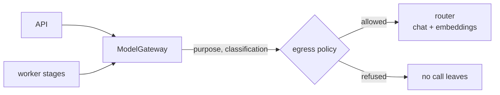

The platform never talks to a model provider. Everything goes through **one adapter, `ModelGateway`**, to an **OpenAI-compatible router** you configure. The router chooses the model; the platform asks for a **purpose**.

## Purposes, not models

Code refers to purposes such as `graph_extraction`, `memory_extraction`, `memory_consolidation`, `ontology_simulation`, `context_compression` and embeddings. A single file (`compat/model-purposes.yaml`) maps each purpose to a router alias and the capabilities it requires (`structured_output`, for example) and a fallback. Swapping a model is a change to that file, not to code, and it is *model-affecting*, so it needs a recorded live gate (`make eval-gate-live`, an owner action).

## What the router must provide

- **Chat completions** with `response_format: json_schema` (structured output). Extraction depends on it.
- **Embeddings.** The embedding size is pinned at **384 dimensions** (`vector(384)` in Postgres, an assertion on every returned vector). Changing the model is a managed re-embed under a new version ([memory-reembed](/docs/operations/memory-reembed/), [ADR-013](/docs/reference/adrs/adr-013-embeddings/)).
- An OpenAI-compatible surface: `POST /v1/chat/completions`, `POST /v1/embeddings`, `GET /v1/models`, `GET /health`. The OpenAI Responses API is not used.

The full contract, with what was verified against a real router, is in the repository: [docs/router-contract.md](https://github.com/osogroup-blair/kg-boilerplate/blob/main/docs/router-contract.md). `make verify-router` checks a live router against it.

## The egress policy

Every call carries a **data classification** and a **purpose**. Before it leaves, the gateway checks the policy: a workspace can narrow what may be sent (for example, deny `restricted` data, or deny a purpose), and consent and the principal's `model_disclosure` setting are applied on the ingestion side. A denied event makes **zero model calls**. The policy is enforced in the transport, not only in the callers.

## Mock vs live

| | Mock (development default) | Live |
|---|---|---|
| Setting | `OSO_ROUTER_MODE=mock` | `OSO_ROUTER_MODE=live` |
| Needs | nothing | non-admin router keys, `OSO_ROUTER_API_KEY_API` and `_WORKER` |
| Answers | Recorded fixtures; in **strict** mode an unmatched structured request fails loudly with `fixture_missing`; otherwise a schema-valid placeholder; chat falls back to echo | The real model |
| Embeddings | Deterministic 384-dimension feature-hashed vectors (lexical similarity only) | The real embedding model |
| Cost | none | per call |

The mock is why the examples are fast, free and identical on every run, and why a gap in a fixture is a visible failure instead of silent junk. The test-only control plane (`/__mock/*`) is never exposed outside your machine.

## Going live

See [going live with a real router](/docs/guides/going-live-with-a-real-router/) for the sequence: verify, run the live session, read the proposed diff, apply it, re-measure.

## Decisions

[ADR-012](/docs/reference/adrs/adr-012-model-gateway-and-router-contract/), [ADR-013](/docs/reference/adrs/adr-013-embeddings/), [ADR-020](/docs/reference/adrs/adr-020-tokenizer-auth-networking/), [ADR-026](/docs/reference/adrs/adr-026-graphiti-extraction-behaviour/).
