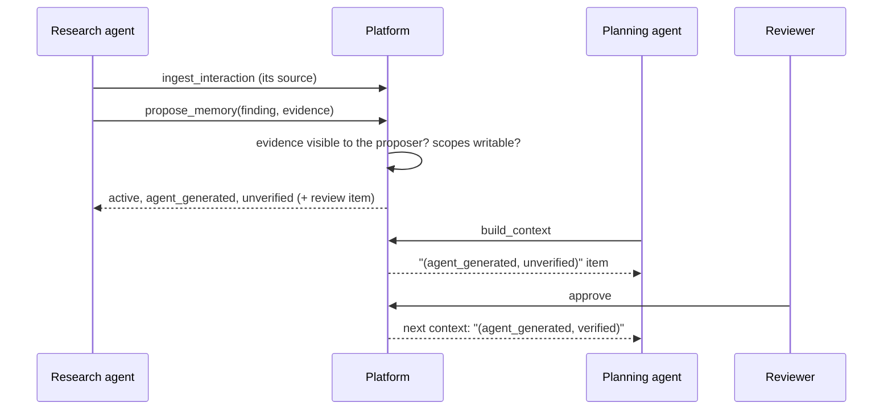

import TapeCall from "../../../../components/TapeCall.astro";

Several agents and apps can share one workspace without seeing each other's private work, and without seeing people they were never granted.

## Principals and roles

A **principal** is an identity that can call the API: a person, an **agent** (an AI worker), or an **app** (a system of record or a conversation source). The workspace and the identity come from the key and from nothing else; sending `workspace_id`, `group_id`, `principal_id` or `agent_id` is a 422 over HTTP and a validation error over MCP.

Roles: `workspace_admin`, `operator`, `reviewer`, `app_writer`, `agent`, `reader`. A registration also carries **grants**, **allowed profiles** (which context recipes it may ask for), **quotas**, a **model-disclosure** policy (may the platform send this agent's submissions to a model?) and `trusted_source` (an app whose commands are authoritative). A new agent gets one key, shown **once**.

<TapeCall tape="sarah" step="3" path="/v1/principals" method="POST" nth={0} pick={["principal.handle","principal.kind","grants"]} items={2} />

## Grants and subject ACLs

A grant is `(scope kind, scope ref, privileges)`: `read`, `propose` and `publish` on a **subject** (a person), a **project**, or a classification. In the ontology, an entity type marked `access: subject_scoped` (people, in the examples) is hidden from anyone without a grant on that person:

| Surface | Rule |
|---|---|
| Entities, directory, summaries | visible only with a subject grant (or an admin or reviewer) |
| Facts and relationships | visible only when **both** endpoints are |
| Graph neighbourhood | a hop never passes through a hidden node |
| Memory | memory scopes; subjects naming a hidden entity are omitted |
| Context | hidden requested subjects are dropped; all hidden gives `denied` |

A hidden id answers **the same 404** as a missing one, so an agent cannot tell whether a person exists. The [permission lens](/see-it/permissions/) shows the two bodies side by side.

## The publish model

Agents share work through labels, not trust:

- `agent_generated` and `verified` are separate labels. An unverified agent finding is a **lead, not a fact**, and the text says so. Ask for `evidence_required=true` to leave them out.
- **Evidence must be readable by the proposer.** Missing, someone else's, hidden or foreign evidence all fail with the same `422 invalid_evidence`.
- **Procedural memory from an agent is always reviewed.**
- A **working note** is private to that principal and run.

## Quotas

Each principal can have a requests-per-minute limit, a daily context-token budget and a daily interaction cap (null falls back to the platform default). Refusals are `429 quota_exceeded` or `rate_limited` with `retry_after`. With `LIMITER_BACKEND=postgres` the limit is shared across API replicas.

## Revocation

Revoking a principal takes effect on the next request (HTTP, SDK and MCP): the key answers 401, the principal's context links 404 for everyone but an admin, and act-as on it is refused. A **compromised** revocation (versus a retired one) also turns what the agent shared into a caution for everyone else and disputes its memories.

## See it, run it, configure it

- **See it:** the [permission lens](/see-it/permissions/) and Sarah steps 5, 6 and 8.
- **Run it:** `make examples-agents`; notebook 05 (multi-agent sharing); the console's Agents & Access.
- **Configure it:** [agent-onboarding](/docs/operations/agent-onboarding/), [agent-revocation](/docs/operations/agent-revocation/); `access:` in the [ontology](/docs/concepts/ontology/).
- **Decisions:** [ADR-036](/docs/reference/adrs/adr-036-agent-registration-trusted-source-and-model-disclosure/), [ADR-037](/docs/reference/adrs/adr-037-ontology-driven-subject-acls/), [ADR-038](/docs/reference/adrs/adr-038-publish-model-and-labels/), [ADR-039](/docs/reference/adrs/adr-039-revocation-retired-vs-compromised/), [ADR-048](/docs/reference/adrs/adr-048-workspace-rls-not-per-principal/).
