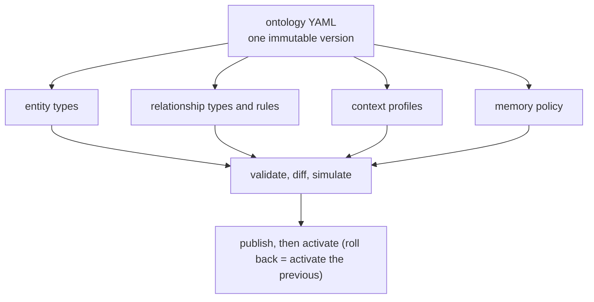

An **ontology** is how you configure the platform for a domain. It is one YAML document with five parts, and **adding a domain needs no platform code**: the CRM and support-desk examples are exactly this.



```yaml
ontology: {id: support-desk, version: 1.0.0, mode: strict}
entity_types:        # what can be known
  Requester:
    identity: {key: platform_uuid, external_id_systems: [desk], aliases: [name]}
    access: subject_scoped
    attributes: {name: {type: string, required: true}}
relationship_types:  # how things relate, with time and rules
  ASSIGNED_TO:
    source: Ticket
    target: Engineer
    temporal: true
    fact_template: "{source} is assigned to {target}"
    rules:
      - require_source
      - preserve_valid_time
      - {kind: succession, params: {match: [source]}}
context_profiles:    # what a context for a task should contain
  ticket_triage: {max_tokens: 600, expected_signals: [...]}
memory_policies:     # what memory may be created and how
  default: {auto_activate: [episodic, semantic], procedural_requires_review: true}
```

## The five parts

| Part | What it decides |
|---|---|
| **`entity_types`** | The kinds of things (Person, Customer, Ticket), their attributes, their identity (declared external id systems, never names), allowed classifications, and `access: subject_scoped` for people whose data needs a grant |
| **`relationship_types`** | Typed edges between two entity types; whether they are `temporal`; a `fact_template` that renders command-written facts as sentences; attributes; and **rules** |
| **Rules** | From a **fixed catalog**: `require_source`, `preserve_valid_time`, `succession`, `max_active_per_source`, `min_authority`, `require_review_if_inferred`, `queue_if` and the always-on structural checks. No expressions, no user code ([rule catalog](/docs/reference/rule-catalog/)) |
| **`context_profiles`** | Caps, what to include, graph and memory settings, compression modes, and `expected_signals` that define **unknowns** deterministically |
| **`memory_policies`** | Whether extraction is on, the importance threshold, which types auto-activate, that procedural memory is always reviewed, TTLs, default scope, archiving, and consolidation |

`mode: strict` rejects anything undeclared; `permissive` warns.

## Versions, validation, simulation, rollback

An ontology is published as an **immutable version**; old provenance stays attached to the old one. Before you publish:

1. **Validate** (`POST /v1/ontologies/versions/{id}/validate`, or in Python `kg_ontology.validate.validate_text`). Errors name the path.
2. **Diff** against the active version. The diff warns, for example, when `access` is tightened.
3. **Simulate** (`POST .../simulate`, or the console's Ontology → Simulate): the draft runs on sample interactions in an isolated staging namespace, reporting results and cost, leaving nothing behind.
4. **Publish** and activate. **Rollback** is activating the previous version; rebuilding the graph under a new ontology goes through a parked namespace and an atomic cut-over ([reindex-ontology](/docs/operations/reindex-ontology/)).

## Why rules are a fixed catalog

Letting a domain ship its own code or expressions would put arbitrary logic on the write path. A fixed catalog keeps every rule table-tested with fixtures and a conflict policy (a meta-test enforces all three), and keeps the deterministic path deterministic.

## See it, run it, configure it

- **Run it:** notebook 07 (the second domain); [model your own domain](/docs/tutorials/first-domain/).
- **Reference:** [the ontology spec](/docs/reference/ontology-spec/) (generated JSON Schema) and the [rule catalog](/docs/reference/rule-catalog/).
- **Guides:** [add a domain](/docs/guides/add-a-domain/), [write context profiles](/docs/guides/write-context-profiles/).
- **Decisions:** [ADR-014](/docs/reference/adrs/adr-014-ontology-compiler/), [ADR-022](/docs/reference/adrs/adr-022-ontology-spec-and-rule-catalog/), [ADR-046](/docs/reference/adrs/adr-046-ontology-simulation-in-staging-namespaces/).
