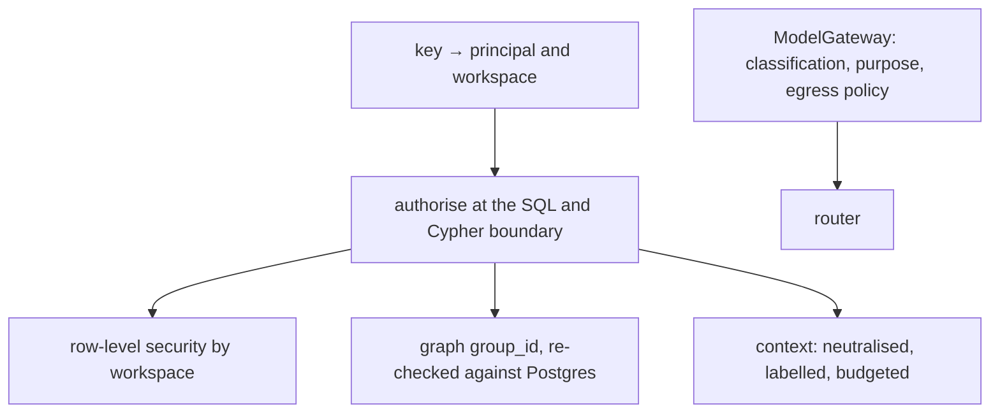

Security rules hold **everywhere**, and each has a test or report that proves it. The full STRIDE review is the [threat model](/docs/reference/threat-model/).

## The rules that hold everywhere

1. **The workspace comes from the key, never from a request field.** A hidden id answers the same 404 as a missing one.
2. **Authorisation is applied at the SQL and Cypher boundary,** not after retrieval. Subject-scoped types hide the whole fact unless both endpoints are visible.
3. **Deterministic paths never call a model:** commands, authorisation, rules.
4. **Retrieved text is data.** Contexts render inside a marked block with a neutraliser; agents are told to quote, not obey.
5. **Revocation is immediate,** and a compromised agent also disputes what it shared.

## Tenancy

Every Postgres table has row-level security keyed by workspace, with **two database roles**: the owner (migrations; it can bypass RLS) and the application role (it cannot). Both processes refuse to start if their role could bypass RLS. The graph is partitioned by `group_id` in one Neo4j database and every graph result is re-checked against Postgres permissions. Database-per-tenant is an open decision ([DEC-06](/docs/project/decisions/)).

## Identity

- **People** sign in through **OIDC** (the console uses PKCE; a refresh cookie is httpOnly and SameSite=Strict). Algorithms are pinned asymmetric: `none` and HMAC are refused.
- **Agents, apps and break-glass** use API keys (`kgk_…`), stored as hashes the application role cannot select; authentication goes through a `SECURITY DEFINER` function. Keys are shown once.
- Keys are re-checked against the database on every request, so revocation is immediate.
- Secrets are files in a restricted directory with a rotation procedure ([rotate-secrets](/docs/operations/rotate-secrets/)).

## Data at rest and in flight

TLS terminates at the edge. Interaction content is **encrypted at rest** (payload keys rotate, [payload-key-rotation](/docs/operations/payload-key-rotation/)). Backups are age-encrypted with key escrow. The deletion journal is an HMAC chain kept outside the database and its backups.

## Egress

Only `ModelGateway` calls the router; calls carry data classification and purpose; a workspace can narrow what may leave. See [models and the router](/docs/concepts/models-and-router/).

## Prompt injection

The engine neutralises structure in retrieved text, labels unverified and agent-generated content, and agents must quote context rather than obey it. A frozen corpus of 45 injection payloads runs through every ingress in the evaluation (`make eval-injection`).

## Abuse limits

Per-route body limits, a per-principal rate limit and daily quotas (shared across replicas with `LIMITER_BACKEND=postgres`), a per-workspace cap on concurrent context builds, and bounded outbox retries with a dead-letter queue.

## Evidence

The evaluation runs about 940 authorization probes (every route against every caller class, plus frozen and deleted subjects) and expects zero policy mismatches and zero leaks. The release sweep runs the leak suites and route walkers against **two API replicas**. See the [proof](/#proof) on the landing page and [the evaluation guide](/docs/guides/evaluation-and-the-release-gate/).

## Reporting a problem

Please report vulnerabilities privately; see the [security policy](/docs/project/security/).
