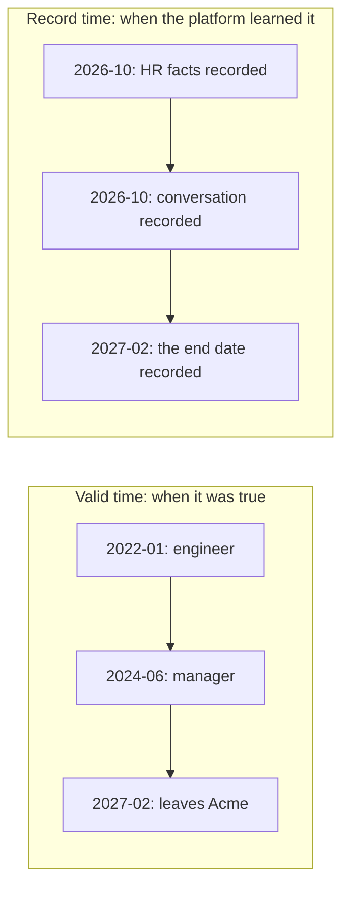

import TapeCall from "../../../../components/TapeCall.astro";

Every fact carries **two kinds of time**, and they answer different questions.

| | Question | Field | Who sets it |
|---|---|---|---|
| **Valid time** | When was this true in the world? | `valid_from`, `valid_to`; query with `as_of` | The source, or the text it came from |
| **Record time** | When did the platform learn it? | `recorded_at`; query with `known_at` | **The database**, never the caller |

## Valid time: `as_of`

Ask for Sarah's relationships as of a date and the platform answers with what was true then. Before February 2027 she works at Acme; after, that fact is history and drops out of the current answer, but it is never deleted:

<TapeCall tape="time" path="/v1/entities" nth={10} pick={["rel_type","valid_from","valid_to","evidence_status"]} items={4} note="as_of 2027-02-15: the Acme fact has ended (valid_to 2027-02-01), so only the open-ended facts remain." />

The same parameter works on `POST /v1/context/build`, so an agent can plan "as of next quarter" or audit "as of last March".

`as_of` must carry a timezone. A source that does not know when something started says `valid_from_unknown` rather than inventing a date; the platform never guesses one.

## Record time: `known_at`

`known_at` answers "what did we believe at that moment?". A fact extracted from a conversation did not exist before that conversation was recorded, even though it describes the present:

<TapeCall tape="time" path="/v1/entities" nth={13} pick={["rel_type","evidence_status","recorded_at"]} note="known_at just before the conversation was recorded: only the HR fact is there. The 'considering entrepreneurship' fact appears later." />

A backdated update shows the difference well. If HR tells you on 5 February that Sarah left on 1 February, `valid_to` is 1 February (the world) and `recorded_at` is 5 February (the platform), and `source_recorded_at` keeps the source's own claim as informational.

:::note
Ending a fact edits its `valid_to` in place, so `known_at` cannot "un-know" an end date. The point-in-time *guarantee* over history rewrites is out of scope for the MVP (DEC-12); valid-time and record-time metadata are kept and queryable.
:::

## Succession versus supersession

- **Succession:** a later fact follows an earlier one. A new role at the same organisation ends the previous one at the new `valid_from`. This is a rule you declare (`succession`), evaluated deterministically.
- **Supersession:** a correction replaces a fact because it was *wrong*. The old fact is marked superseded; evidence is never rewritten, a correction appends.

In the support-desk example, assigning a ticket to a new engineer ends the previous assignment by succession, so `as_of` before the change still shows the old engineer.

## Context stays honest about time

A context package reconciles time before ranking: current facts are those open at the requested `as_of`, ended facts are history, and an `unverified` current fact is labelled as such.

## See it, run it, configure it

- **See it:** the [time-travel playground](/see-it/time/), then Sarah step 7.
- **Run it:** notebook 02 (the temporal graph as of a date).
- **Configure it:** `temporal: true` on a relationship type, with the `preserve_valid_time` and `succession` rules ([rule catalog](/docs/reference/rule-catalog/)).
- **Decisions:** [ADR-017](/docs/reference/adrs/adr-017-temporal-mapping/), [ADR-023](/docs/reference/adrs/adr-023-succession-vs-supersession-and-record-time/).
