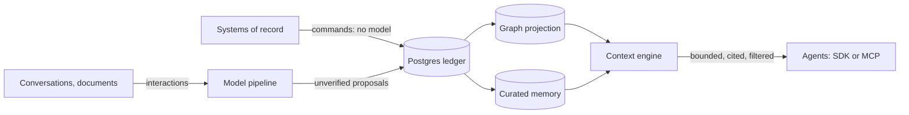

The Knowledge Graph Boilerplate is a **multi-tenant memory and knowledge service for agents and applications**. You send it facts and conversations; an agent asks it one question, "what do I need to know to do this task?", and gets back a **bounded, cited, permission-filtered context package** it can put in a prompt.

It is a boilerplate, not a hosted product: you clone it, run it, change the ontology to your domain, and deploy it. Everything runs on Postgres and Neo4j, with a model router you choose (or a deterministic mock while you learn).

## The problem it solves

Agents that act on people, customers or projects need more than a chat log or a vector store:

- **History they can trust.** What is a verified fact from a system of record, and what is something a model inferred from a conversation?
- **Time.** A fact stops being true. "Sarah works at Acme" was right in 2026 and is history in 2027, but it must stay queryable.
- **Permissions.** One customer's contacts must not appear in another's context. A private working note must stay private to the agent that wrote it.
- **Correction and deletion.** When a fact is wrong, rejecting it must change what agents see next. When a person asks to be forgotten, you need a receipt that proves it.

## How it works in one minute

1. **Facts from systems** (HR, CRM, your app) go in as validated **commands**. No model is involved; the graph is projected deterministically.
2. **Conversations and documents** go in as **interactions**. A model pipeline extracts entities, facts and memories, and they arrive **unverified**.
3. **Postgres is the source of truth.** The graph and the memory index are projections you can rebuild.
4. **One call**, `POST /v1/context/build`, turns the graph and memory into a package under a hard token budget, with citations, explicit unknowns and conflicts, filtered by what the caller may see.
5. **Governance** is built in: corrections with an impact preview, deletion with a receipt, legal holds, audit, revocation.

## What you get in the box

| Piece | What it is |
|---|---|
| API | A FastAPI service, `/v1/...`, 109 paths, one error envelope |
| Worker | The pipeline stages, with leases, retries and a dead-letter queue |
| Admin console | React: graph explorer, context lab, memory explorer, review queue, deletions, ontology editor |
| Python SDK | `KGClient` (async) and `KGClientSync` |
| MCP server | Nine tools for Claude Code, Claude Desktop or any MCP client |
| CLI | `kg`: workspaces, keys, reconcile, backups, deletion sweeps |
| Examples | The Sarah scenario, a CRM domain, a support-desk domain, agents, seven notebooks |
| Evaluation | Frozen datasets and a release gate: leakage 0, budget 100%, attribution 100% |

## What it is not

- **Not a vector database or a RAG framework.** It has hybrid memory search, but the point is the governed, time-aware context around it.
- **Not a model.** It calls a router you configure; extraction quality depends on the model behind it.
- **Not finished infrastructure.** It is pre-1.0: the release candidate and the live-router session are owner actions, and one production decision (graph tenancy) is recorded but open. See the [roadmap and status](/docs/project/roadmap/).

## Where to go next

- **See it first:** the [interactive playgrounds](/see-it/), no install.
- **Run it:** the [quickstart](/docs/get-started/quickstart/), about ten minutes, no model key.
- **Learn the ideas:** [architecture](/docs/concepts/architecture/), then [commands vs extraction](/docs/concepts/commands-vs-extraction/), [time](/docs/concepts/time/) and the [context engine](/docs/concepts/context-engine/).
- **Build with it:** [model your own domain](/docs/tutorials/first-domain/) or [connect an agent](/docs/tutorials/connect-an-agent-sdk/).

New terms are in the [glossary](/docs/get-started/glossary/).
