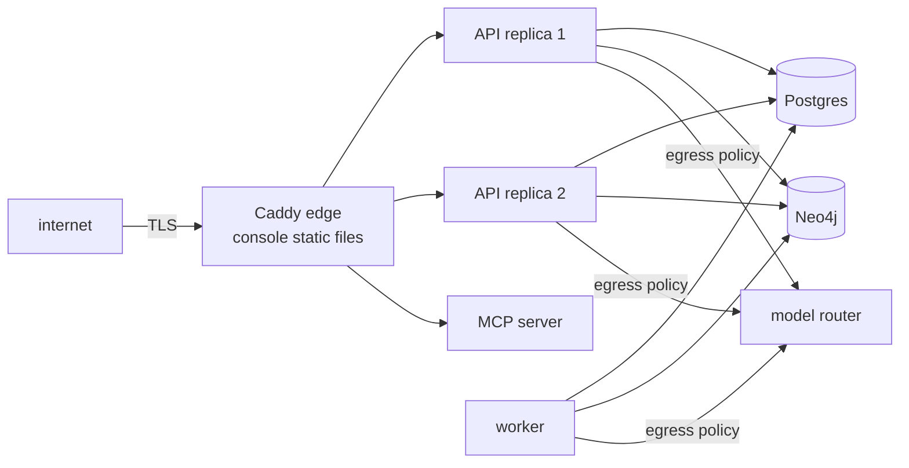

The production reference is `deploy/compose/docker-compose.prod.yml` behind a Caddy edge. It is a single-host Compose deployment, deliberately simple, with the controls a larger platform would also need.

## What is in it

- **TLS and one host name** for the console, the API and the MCP server (`KG_PUBLIC_HOST`; `KG_TLS` is the ACME contact e-mail, or `internal` for a private CA).
- **At least two API replicas**, balanced by least connections and taken out while `/health` fails, with a shared limiter in Postgres.
- Read-only containers, non-root processes, internal-only networks for the databases, and generated secrets (files in a 0700 directory; the one documented exception is Neo4j's data directory).
- **Backups** (age-encrypted, with key escrow), a restore rehearsal, and a deletion journal kept outside the database.
- **Observability:** Prometheus rules (`deploy/observability`) and a Grafana dashboard, with SLO thresholds marked as proposals until you set them.

## Sizing

Postgres dominates, and **search dominates Postgres**: an exact cosine scan costs about 2.5 cores per search per second at 50,000 memories. The runbook's sizing table gives two tiers (small: 8 vCPU / 16 GB; reference: 16 vCPU / 32 GB), with the arithmetic so you can redo it for your load. An approximate-nearest-neighbour index would change the table and is the planned fix before any workspace passes about 50,000 memories.

## Steps

1. Read the runbook end to end: [deploy-production](/docs/operations/deploy-production/).
2. Create secrets: `make prod-secrets` (never overwrites; git-ignored).
3. `cp deploy/compose/prod.env.example .env.prod` and set the public host, TLS contact, router URL, Neo4j heap and page cache from the sizing, and the OIDC block if SSO is ready ([oidc-setup](/docs/operations/oidc-setup/)).
4. Bring it up and prove the claims: `make prod-smoke` starts the production compose under a scratch project and checks TLS, read-only containers, internal networks, non-root users and break-glass.
5. Create the first workspace and administrator with `kg workspaces create`.
6. Set the open decisions: SLOs (DEC-11), retention and backup windows (DEC-07), and decide graph tenancy (DEC-06) knowing it is application-enforced today.
7. Schedule backups and the rehearsal (`deploy/systemd/kg-backup.timer`, `kg-rehearsal.timer`) and read [backup-restore](/docs/operations/backup-restore/).
8. Run the release gates: [evaluation and the release gate](/docs/guides/evaluation-and-the-release-gate/), and sign the [release checklist](/docs/project/release-checklist/).

## Day two

[Rotate secrets](/docs/operations/rotate-secrets/) on a schedule, [upgrade pinned dependencies](/docs/operations/upgrade-pin-dependencies/) deliberately, and keep the runbooks for [LLM outage](/docs/operations/llm-outage/), [graph outage](/docs/operations/graph-outage/) and [stuck jobs](/docs/operations/stuck-job-replay/) to hand.
