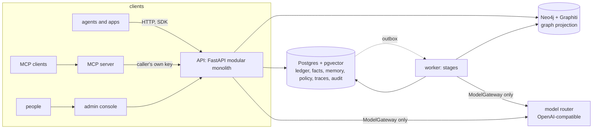
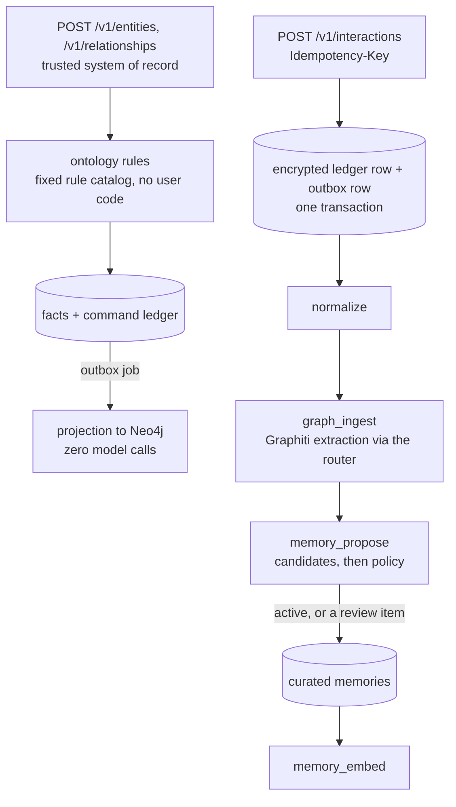

# Architecture overview

One page. The detail lives in the phase documents (`p1-foundation.md` .. `p9-release.md`), the ADRs, and the blueprint in `solution_inputs/knowledge-memory-platform-blueprint/`.

## The pieces

- **Postgres is authoritative.** The ledger, facts, curated memory, embeddings, policies, traces and audit all live there, under row-level security keyed by workspace. Two database roles: the owner migrates, the application role cannot bypass RLS (both processes refuse to start otherwise).
- **Neo4j is a projection.** The graph is rebuilt or repaired from Postgres; its `group_id` is the workspace. Graphiti is used through one adapter. ([ADR-015](../adr/ADR-015-graph-tenancy.md), [ADR-016](../adr/ADR-016-deterministic-write-path.md))
- **One model door.** Only `ModelGateway` calls the router; calls carry the data classification and purpose, so an egress policy can refuse a call before it leaves. ([ADR-012](../adr/ADR-012-model-gateway-and-router-contract.md))
- **The SDK and MCP server are thin.** They hold no credential and forward the caller's key, so an agent sees exactly what it would see over HTTP. ([ADR-040](../adr/ADR-040-sdk-and-mcp-boundary.md))

## Write path

- **Commands never call a model.** They are validated against the published ontology, recorded in a command ledger and projected deterministically. ([ADR-016](../adr/ADR-016-deterministic-write-path.md), [ADR-021](../adr/ADR-021-command-ledger-and-state-based-projection.md))
- **Interactions are idempotent and durable.** The same key and body is one event; a different body is a 409. The event and its outbox job are written together, and a worker with leases, backoff and a dead-letter queue does the rest, effectively once. ([ADR-024](../adr/ADR-024-interaction-ledger-idempotency-and-encryption.md), [ADR-025](../adr/ADR-025-outbox-and-effectively-once.md))
- **Extracted knowledge starts unverified.** A fact or memory from a conversation is labelled; policy decides what activates (episodic and semantic may, procedural never without a person). ([ADR-029](../adr/ADR-029-curated-memory-model-scopes-and-visibility.md), [ADR-030](../adr/ADR-030-memory-extraction-policy-and-prompt-safety.md))
- **Agents publish through a model of labels.** `agent_generated` and `verified` are separate; evidence must be readable by the proposer. ([ADR-038](../adr/ADR-038-publish-model-and-labels.md))

## Read path: `POST /v1/context/build`
plan and pick a profile → authorise → retrieve graph and memory in parallel (prefiltered by workspace, subject and scope) → merge and deduplicate → reconcile time → rank (`ctx-rank.v1`, recorded weights) → pack under a hard token budget, enforced on the rendered text → attach citations, unknowns and conflicts → record a metadata-only trace.
- **Unknowns are deterministic**: a profile's `expected_signals` say what a complete answer needs; whatever is absent is reported, no model guesses. ([ADR-032](../adr/ADR-032-context-package-contract-and-status.md), [ADR-033](../adr/ADR-033-ranking-and-packing.md))
- **A package is explained, never stored**: asking for an old one re-materialises it under today's access and facts; anything that changed comes back `withdrawn`. ([ADR-034](../adr/ADR-034-traces-rematerialization-and-debug-snapshots.md))
- **Search** is lexical + vector fused by rank, with the authorisation predicate inside the candidate scan, never filtered afterwards. ([ADR-031](../adr/ADR-031-hybrid-scoped-search-and-ranking.md))

## Time
Every fact has **valid time** (`as_of`: when it was true) and **record time** (`known_at`: when the platform learned it, set by the database). A later role at the same organisation *succeeds* the earlier one; a correction *supersedes*. ([ADR-017](../adr/ADR-017-temporal-mapping.md), [ADR-023](../adr/ADR-023-succession-vs-supersession-and-record-time.md))

## Security rules that hold everywhere
1. The workspace comes from the authenticated principal, never from a request field. A hidden id answers the same 404 as a missing one.
2. Authorisation is applied at the SQL and Cypher boundary. Subject-scoped types hide the whole fact unless both endpoints are visible. ([ADR-037](../adr/ADR-037-ontology-driven-subject-acls.md), [ADR-048](../adr/ADR-048-workspace-rls-not-per-principal.md))
3. Deterministic paths (commands, authorisation, rules) never call a model.
4. Retrieved text is data: contexts are rendered inside a marked block with a neutraliser, and agents are told to quote it, not obey it. ([docs/agent-integration.md](../agent-integration.md))
5. Revocation is immediate; a compromised agent also disputes what it shared. ([ADR-039](../adr/ADR-039-revocation-retired-vs-compromised.md))

## Governance
Corrections, identity merge and split are audited ledger commands with an impact preview ([ADR-041](../adr/ADR-041-corrections-and-authoritative-overrides.md), [ADR-042](../adr/ADR-042-identity-split.md)). Deletion is freeze → plan → purge → verify → receipt, with legal holds and a journal that makes a restored backup forget again ([ADR-044](../adr/ADR-044-deletion-lifecycle-purge-gate-and-verification.md), [ADR-045](../adr/ADR-045-suppression-tombstones-and-the-deletion-journal.md)).

## Where to look in the code
| Concern | Where |
|---|---|
| HTTP routes | `apps/api/src/kg_api/routers` (registry: `ALL_ROUTERS`) |
| Worker stages | `apps/worker`, `packages/jobs`, `packages/extraction`, `packages/memory` |
| Ontology and rules | `packages/ontology` |
| Facts, commands, reads | `packages/knowledge` |
| Context engine | `packages/context` |
| Governance, deletion | `packages/governance` |
| Reconcile, reindex, backups | `packages/reconcile`, `tools/backup` |
| Import boundaries | `pyproject.toml` (22 import-linter contracts) |
