# Phase 2 architecture: ontology registry and deterministic commands

Plan: [phase-2-ontology-and-commands.md](../plans/phase-2-ontology-and-commands.md). Decisions: [ADR-021](../adr/ADR-021-command-ledger-and-state-based-projection.md), [ADR-022](../adr/ADR-022-ontology-spec-and-rule-catalog.md), [ADR-023](../adr/ADR-023-succession-vs-supersession-and-record-time.md).

## Packages
```
kg_ontology  pure: spec, canonical hash, validator, diff, rule catalog + evaluators, template renderer   (no db / graph / http imports)
kg_graph     + compile.py (ontology -> Graphiti types, the GraphCompilerPort) and ScopedGraph writes / read-backs
kg_knowledge OntologyService, CommandPipeline, Reads, Projector, sweeper job, SpecCache
kg_api       routers: ontology, entities, relationships, commands (all in ALL_ROUTERS)
kg_worker    runs the projection sweeper next to the heartbeat; registers the `graph_projection` JobHandler
kg_cli       kg graph reconcile · kg commands retry-projection · kg seed demo --ontology
```
import-linter keeps `kg_ontology` free of database, graph, model and framework imports, and `kg_graph` free of `kg_knowledge`.

## Ontology lifecycle

```mermaid
stateDiagram-v2
  [*] --> draft: POST /versions (YAML or JSON, or copy_of)
  draft --> draft: PUT (If-Match) · validate · diff
  draft --> published: publish (validate + compile check + rule tests; hash; optional activate)
  published --> published: activate = rollback (appends an activation, edits nothing)
  published --> retired: retire (not the active one)
  draft --> [*]: DELETE (drafts only)
```

A published version cannot change, even for the table owner (trigger). `ontology_activations` is append-only. `workspace_ontology` holds the one active version and is the lock that serialises publish and activate.

## Command pipeline
```mermaid
sequenceDiagram
  participant C as Client (app / admin)
  participant A as API route
  participant P as CommandPipeline
  participant DB as Postgres (one tenant transaction)
  participant J as Projector
  participant N as Neo4j + router
  C->>A: POST /v1/relationships (Idempotency-Key)
  A->>DB: BEGIN; set workspace
  A->>P: run(command)
  P->>DB: lock key; known key? replay or 409
  P->>DB: active published ontology (none: 409 no_active_ontology)
  P->>DB: resolve endpoints; lock source entity; load its active facts
  P->>P: evaluate rules in blueprint order (pure)
  alt any reject
    P->>DB: store command (rejected) + audit; 422 rule_violation
  else queue_review
    P->>DB: store command + review item + audit; 202 needs_review
  else apply
    P->>DB: store command, insert fact, end predecessors, audit
  end
  A->>DB: COMMIT
  A->>J: project_command (budget 5 s)
  J->>N: embeddings (graph_projection) then direct node/edge save
  J->>DB: projection_status = projected
  A-->>C: 201 (projected) or 202 + status URL (the sweeper finishes it)
```

## Data (migration 0002)
`ontology_versions` (immutable once published) · `ontology_activations` (append-only) · `workspace_ontology` · `commands` (immutable ledger) · `entities` · `entity_external_ids` (unique per workspace/type/system/value: the only identity) · `facts` (valid + record time, status, authority, provenance) · `review_items` · `idempotency_records` (24 h). Every table has `workspace_id`, composite foreign keys, `ENABLE` + `FORCE` RLS and explicit grants (column-level on `commands`, `entities`, `facts`, `ontology_versions`). `ops.workspaces_with_pending_projection()` (SECURITY DEFINER) returns workspace ids only.

## Authorization additions
`ontology.read|write|publish`, `entity.read|write|read_sensitive`, `command.read`. Admins hold all; `app_writer` writes commands; every role reads ontology and entities; reviewer, operator, app_writer read the ledger; only admins see sensitive attributes. No P1 cell changed (`test_policy` asserts the full table).

## Deviations from the plan (and why)
- **`workspace_ontology.active_version_id` is nullable.** The row is the publish/activate lock, and it must exist before the first version is published; a trigger still requires a non-null pointer to name a *published* version.
- **`ontology_key` / `version` are nullable on drafts.** An invalid draft (for example a YAML syntax error) must still be saved so it can be fixed (ONT-01); published rows require both (CHECK).
- **`entities.ontology_version_id` moves with `entity.update`** (the version the last write ran under); a fact keeps the version it was asserted under.
- **`last_command_id` on entities and facts.** A command's projection status is derived from the rows it created or last changed (a succession changes the predecessor fact).
- **`POST …/validate` is read-only** (`ontology.read`). The stored report is refreshed by create/replace; validate recomputes without writing.
- **Idempotency replay returns the logical result.** A replayed command returns the same ids and status class; `projection_status` reflects the current state, not the state at the first answer.
- **A missing `Idempotency-Key` is `400 idempotency_key_required`** (not 422) so clients can tell it from a body error.
- **Route-walker test** (`tests/security/test_p2_isolation.py`): every P2 route with an id in its path is probed with a foreign and a random id; a new route that is not classified fails the build.
- **`LOG_LEVEL=DEBUG` hardening** found while testing for content in logs (see ADR-021).

## Decisions from the plan (§13): what P2 implemented — **resolved** (confirmed at the start of P3)
The five recommendations below were kept through P3; two have a named follow-up (a per-principal trusted-app flag in P7, a code editor for the YAML tab).
1. **One active ontology per workspace** (implemented, as recommended). Versions of a workspace share one `ontology_key`; publishing a different key is `409 ontology_key_mismatch`. Several ontologies per workspace would need a namespace on every type key.
2. **Authority mapping**: every `app_writer` principal is `authoritative_system`, every `workspace_admin` is `admin_asserted` (the higher role wins). A per-principal "trusted app" flag is still open for P7.
3. **Sensitive attributes are Postgres-only** (implemented, as recommended): never in Neo4j, fact text, embeddings, logs, metrics, audit, `model_calls`, or the stored command payload (redacted there too). Only `entity.read_sensitive` (workspace admin) sees them.
4. **The YAML tab is a plain monospace textarea**, so no editor dependency was added. A code editor (CodeMirror) is still open; the YAML text round-trips through the same PUT, so adding one changes only that tab.
5. **`local_only` projection**: PJ-02 failed (Graphiti cannot save a node or edge without an embedding), so `local_only` entities are stored Postgres-only with `projection_status=skipped_by_policy` (ADR-021). If a local embedding model is added later, the projector's egress check is the one place to change.
