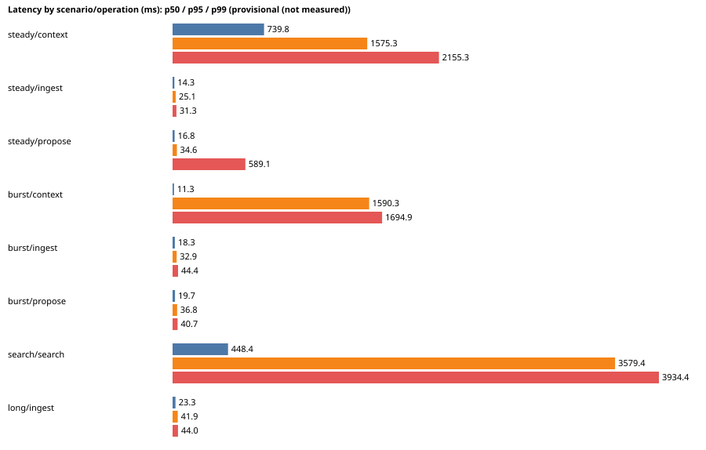

# Baseline 2026-10-18

**Latency model: provisional (not measured).** These numbers describe the platform plus a MODELLED router; they are provisional until the live profile is captured.

Per-principal rate limits (60 context builds/min, 1200 requests/min by default) are raised on the perf stack: one load agent stands in for many. A single agent in production is capped by them, so a client that builds contexts faster than 1 per second gets 429s by design.

Dataset: M (5000 entities, 25000 facts, 50000 memories) in a workspace beside the others of the shared database.

| Scenario | Operation | n | errors | /s | p50 ms | p95 ms | p99 ms |
|---|---|---|---|---|---|---|---|
| steady (4/s) | context | 271 | 19 | 3.0 | 739.8 | 1575.3 | 2155.3 |
| steady (4/s) | ingest | 55 | 0 | 0.61 | 14.3 | 25.1 | 31.3 |
| steady (4/s) | propose | 34 | 0 | 0.38 | 16.8 | 34.6 | 589.1 |
| burst (40/s) | context | 849 | 674 | 27.24 | 11.3 | 1590.3 | 1694.9 |
| burst (40/s) | ingest | 227 | 0 | 7.28 | 18.3 | 32.9 | 44.4 |
| burst (40/s) | propose | 98 | 0 | 3.14 | 19.7 | 36.8 | 40.7 |
| search (8/s) | search | 326 | 0 | 7.63 | 448.4 | 3579.4 | 3934.4 |
| long (1/s) | ingest | 36 | 0 | 0.86 | 23.3 | 41.9 | 44.0 |

## Freshness (accepted to terminal)

| Scenario | events | settled | p50 s | p95 s | max s |
|---|---|---|---|---|---|
| steady | 55 | 55 | 90.6 | 147.2 | 211.1 |
| burst | 227 | 81 | 150.7 | 306.4 | 319.6 |
| long | 36 | 36 | 59.7 | 104.1 | 149.1 |

## Cost and storage

| Scenario | cost per event (USD) | Postgres bytes per 1k events | worker throughput (jobs/s by stage) |
|---|---|---|---|
| steady | 0.000356 | 78345309 | {"memory_propose": 0.23, "graph_ingest": 0.23, "normalize": 0.23, "graph_projection": 0.23, "memory_embed": 0.14} |
| burst | 0.000127 | 18982343 | {"memory_propose": 0.24, "graph_ingest": 0.24, "normalize": 0.68, "graph_projection": 0.02, "memory_embed": 0.29} |
| search | None | None | {} |
| long | 0.000626 | 28672000 | {"memory_propose": 0.24, "graph_ingest": 0.24, "normalize": 0.24, "graph_projection": 0.24} |

## Size curve

| Size | memories | search p50 | search p95 | context p50 | context p95 |
|---|---|---|---|---|---|
| S | 10000 | 175.5 | 752.7 | 254.1 | 346.1 |
| M | 50000 | 470.2 | 2942.0 | 1140.4 | 1651.4 |
| L | 200000 | 1193.6 | 2602.5 | 1603.8 | 1702.1 |

## ANN trigger

Trigger: 200000 memories in one workspace, or a memory-search p95 above 100 ms. Fit: {'intercept': 1540.33, 'per_100k_memories': 644.7}. Memories at 100 ms: -223410. **ANN needed before L: True.**

## Proposed SLOs (the owner sets the values)

- **context_build_p95_ms**: {"measured": 1575.3, "proposed": 2400.0, "at": "M dataset, 4 req/s mixed"}
- **freshness_p95_s**: {"measured": 147.2, "proposed": 295.0}
- **api_error_rate**: {"measured_max": 0.7939, "proposed": 0.001}
- **events_terminal**: {"proposed": "99% of events indexed or needs_review within the freshness SLO; zero silent loss"}
