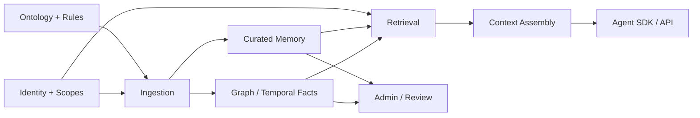

# Capability Map and Ownership

**Parent:** [Blueprint index](../README.md)  
**Purpose:** Translate the product into independently plannable platform capabilities.

| ID | Domain | Capability | MVP depth | Owning logical service |
|---|---|---|---|---|
| CAP-01 | Admin | Ontology type registry and publishing | Create/version entity and relationship definitions | Ontology |
| CAP-02 | Admin | Declarative constraint catalog | Validation, temporal, review, inference rules | Rule policy |
| CAP-03 | Knowledge | Entity identity and resolution | Canonical IDs, alias linking, manual merge review | Knowledge |
| CAP-04 | Knowledge | Temporal relationship state | Historical facts, supersession, as-of queries | Knowledge |
| CAP-05 | Evidence | Interaction and episode ingestion | JSON, text and message episodes | Ingestion |
| CAP-06 | Evidence | Provenance and correction | Source linkage, confidence labels, reviewer actions | Quality |
| CAP-07 | Memory | First-class curated memory | Semantic, episodic, procedural, working scopes | Memory |
| CAP-08 | Memory | Lifecycle and consolidation | Create, upsert, supersede, consolidate, expire, delete | Memory |
| CAP-09 | Retrieval | Hybrid search | Graphiti hybrid facts + pgvector memories | Retrieval |
| CAP-10 | Context | Context compilation | Task-sensitive rank/compress/budget/trace | Context |
| CAP-11 | Agent | Multi-agent contracts | Authenticated context fetch, proposals, scopes | Agent integration |
| CAP-12 | Admin | Knowledge workspace | Browse graph, memories, events, history, source | Admin |
| CAP-13 | Admin | Quality workflow | Review queue, conflict resolution, duplicate merge | Quality |
| CAP-14 | Platform | Access, workspace isolation and audit | Default deny, roles and source classification | Governance |
| CAP-15 | Platform | Reliable async processing | Outbox, idempotency, retries, dead-letter, replay | Runtime |
| CAP-16 | Platform | Diagnostics and evaluation | Context inspector, traces, LLM cost and test harness | Operations |
| CAP-17 | Platform | Portability and deployment | Docker Compose, migrations, sample workspace | Operations |
| CAP-18 | Extensions | Connectors and templates | Contract now, multiple connectors later | Integration |

## Capability priorities

**Release-ready minimum:** CAP-01–CAP-16 with narrow but complete implementations, plus CAP-17. The goal is a complete vertical slice, not shallow screens for every concept. CAP-18 is a design seam only.

## Responsibility boundaries

| Responsibility | Platform-owned? | External / framework role |
|---|---|---|
| Source episodes, entity/fact extraction | Adapter and policy enforcement | Graphiti + Neo4j |
| Curated memory and agent-specific working state | Yes | PostgreSQL + pgvector |
| Knowledge context ranking and packing | Yes | Model adapter optional for compression |
| Tenant authorization | Yes, always | Database namespace alone insufficient |
| Domain ontology config and migrations | Yes | Pydantic/Graphiti types at ingest boundary |
| End-user business UI | No | Built by consuming application |
| Agent planning/execution loop | No | External agent framework |

## Dependency relationships

See [implementation slices](../05-delivery/01-implementation-slices.md) for delivery order.
