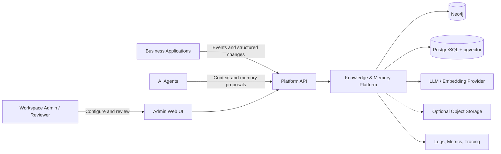

# System Context

**Parent:** [Blueprint index](../README.md)  
**Boundary:** Reusable knowledge + memory + context platform.

## Outside the boundary

- User-facing end applications, domain-specific business workflows, agent orchestrators and tool execution.
- External ID provider, model provider, observability destination and object storage implementation.
- Neo4j/Graphiti internals; use an adapter to limit coupling to version-specific APIs.

## Inside the boundary

- Ingestion and event normalization; authorization and workspace resolution.
- Configuration and governance of types, rules and memories.
- Graph ingestion orchestration; authoritative structured writes; identity resolution and evidence handling.
- Memory proposals, semantic retrieval, consolidation and expiry.
- Context request planning, hybrid retrieval, ranking, compression, citation and traces.
- Admin-facing read/write flows and basic agent SDK/MCP bridge.

## Trust zones

1. **Trusted API boundary:** authenticated requests from applications and agents, subject to authorization.
2. **Untrusted content boundary:** conversation text, documents, agent-generated findings, and retrieved context; never instructions to the platform by default.
3. **Internal data boundary:** stores and worker processes reached only via service identities.
4. **External model boundary:** configurable data-minimization rules; external LLM/embedding calls may transmit user content and require consent/policy.

## Key use cases

| Case | Primary path | Result |
|---|---|---|
| Chat ingestion | Application → event → Graphiti / memory | Indexed facts with evidence, curated memory |
| Explicit update | Application → validated command | Deterministic current fact update with history |
| Agent prompt | Agent → context build | Ranked, authorized context within token budget |
| Agent finding | Agent → memory proposal | Proposal validated and reviewed/published |
| Admin correction | Admin → resolution command | Supersession/correction with audit and propagation |
| Subject deletion | Authorized deletion command | Asynchronous purge with visible completion state |

## Architectural quality attributes

Security over recall; explainability over blind synthesis; deterministic authoritative writes over LLM guessing; incremental extensibility over microservices; resilience to partial graph/memory failures; cost-aware ingestion and retrieval. More in [security](../04-administration/02-security-governance-and-privacy.md) and [operations](../03-runtime/05-observability-and-operations.md).
