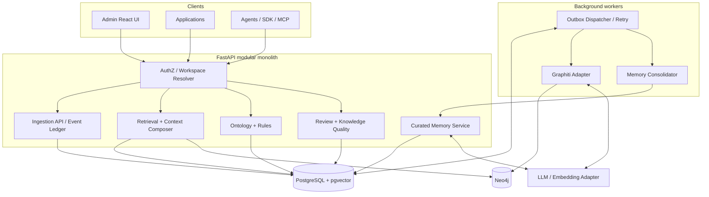

# Runtime Components and Data Ownership

**Parent:** [Blueprint index](../README.md)  
**Baseline:** Two database engines and a modular-monolith service boundary.

## Physical deployments

- `api`: FastAPI; domain modules in one codebase.
- `worker`: same codebase, distinct process for asynchronous ingestion, memory extraction, consolidation and repair.
- `admin`: static frontend/browser app.
- `postgres`: structured authoritative platform state and curated memory.
- `neo4j`: graph and Graphiti episode/fact data.
- `optional`: object storage and external identity/model/metrics services.
- MVP MAY use PostgreSQL outbox polling; broker/Kafka/Redis is not required.

## Data ownership matrix

| Object / content | Canonical owner | Other representation | Consistency |
|---|---|---|---|
| Workspaces, users/agents, permissions | PostgreSQL | No authoritative copy in graph | Strong in API |
| Ontology/policy versions | PostgreSQL | Compiled graph ingestion configuration | Versioned |
| Application interaction envelope, checksum, source pointer, processing state | PostgreSQL | Graphiti episode in Neo4j | Eventual |
| Graphiti episode and extracted relationships | Neo4j | Referenced by PostgreSQL event ledger | Eventual |
| Current/historical extracted graph facts | Neo4j | Read through service, not mirrored indiscriminately | Eventual |
| Verified domain facts submitted via commands | Application-owned source + platform command ledger | Projected into Neo4j | Eventual; API ensures status |
| Curated memory content, status, permissions and embeddings | PostgreSQL | Link/summary reference may exist in Neo4j | Eventual |
| Context traces, request metadata, retrieval decisions | PostgreSQL | No need for full prompt persistence by default | Durable metadata |
| Large documents/media | Optional object storage | URI + checksum + access metadata in PostgreSQL | Eventual |
| Graph deduplication/correction actions | PostgreSQL audit and command log | Applied in Neo4j | Eventual |

## Explicit duplication policy

Graphiti usually retains episode source representations. The PostgreSQL ledger should store normalized event envelopes and, where needed for audit/replay, an encrypted raw payload or an object-store pointer. Duplication is **intentional but governed**. Do not keep separate unbounded copies in every store; define retention, redaction and deletion propagation.

## Write consistency

An incoming interaction commits to PostgreSQL with an outbox entry in one transaction. Worker then calls Graphiti and memory pipeline; completion states record each derivative. There is no distributed cross-database transaction. The API exposes `accepted`, `processing`, `indexed`, `partial`, `failed` and `deletion_pending` where applicable. Retrieval may show a freshness watermark.

## Technology flexibility

Graphiti is an adapter, not the owner of platform security or memory API semantics. The platform must not assume Graphiti handles memory scope authorization, confidence policies, or curated memory lifecycle. The document set uses **proposed** table names/HTTP contracts and does not claim they exist in the library.
