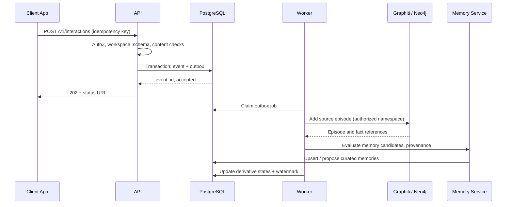
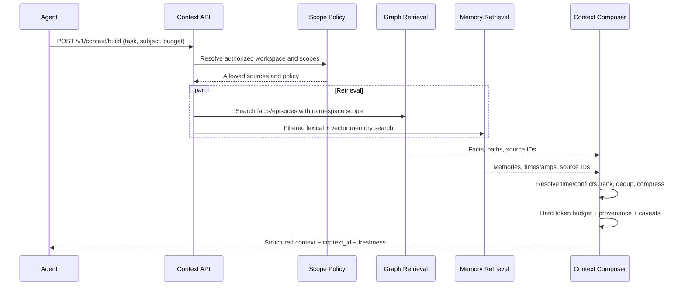

# End-to-End Flows

**Parent:** [Blueprint index](../README.md)

## Flow A — Interaction ingestion and memory formation

**Branching:** The interaction can produce graph facts, memories, both or neither. Failure of one derivative records `partial`, not silent success. Retry is idempotent.

## Flow B — Deterministic authoritative fact

A trusted application submits a typed change, such as an employment termination with effective date. The API validates ontology, authorization, expected revision and time rules; it records the command and applies a deterministic graph mutation (through a controlled adapter). An LLM MAY produce explanatory text but MUST NOT decide whether the command occurred. Persist history and source command ID.

## Flow C — Context retrieval

**Graceful degradation:** If a backend fails, the response must identify `partial` completeness and excluded sources or fail closed, based on request policy. It must never silently claim complete context.

## Flow D — Correction or identity merge

Admin selects disputed fact or duplicate identity → sees sources/dependents → submits reason and target correction → command is audited → projection is updated → memory references/context caches are invalidated → tests verify old belief is no longer presented as current. Original evidence is not fabricated or silently rewritten.

## Flow E — Deletion

Authorized subject/workspace deletion → freeze future retrieval immediately → enumerate episode/memory/embedding/graph/trace/source copies → delete or redact by policy → verify derivative removal and backup expiry requirements → expose completion receipt. Where historical integrity or legal hold prevents full erasure, clearly communicate restriction and applicable policy.

## Flow F — Rebuild / ontology change

Publish ontology version after impact check → route new ingestion to pinned config → optionally re-ingest historical sources into a **separate namespace** → run evaluations → cut over atomically at routing layer → retire old projection after review. Do not assume a schema change retrospectively fixes existing entities.
