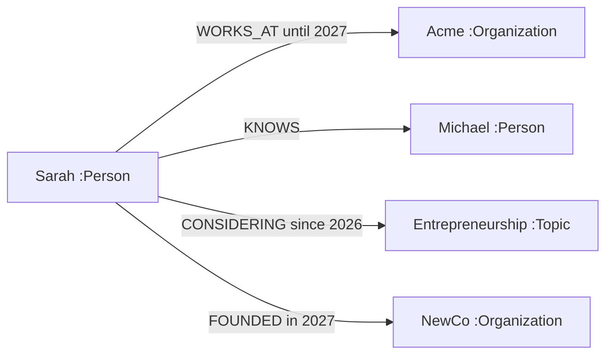

# Entity Identity and Temporal Graph

**Parent:** [Blueprint index](../README.md)  
**Capability owners:** CAP-03 / CAP-04

## Model

Entity nodes represent objects with independent identities (people, organizations, assets, projects, topics). Relationship/fact edges connect them. Stable identifiers are platform-namespace-qualified, not derived only from names. A relationship has a type and may carry props such as role, amount and source evidence.

## Canonical identity and aliases

- Assign UUID or ULID per tenant/workspace. Keep separate `display_name`, `aliases`, external identifiers and normalized matching keys.
- `Sarah Johnson` and `S. Johnson` are **candidate matches**, not automatic identical IDs.
- Resolve using domain identity strategies, strong IDs, contextual attributes and model suggestions. Ambiguous merges enter a review queue.
- Merge actions preserve redirection aliases, audit trail and references; a split is a compensating operation and may trigger reindex/re-extraction.

## Time semantics

Track **valid time** and **record time** separately:

| Field | Meaning | Example |
|---|---|---|
| `valid_from` | When a fact became true in the world | promotion effective June 1 |
| `valid_to` | When it stopped being true | role ended May 31 next year |
| `recorded_at` | When the system learned/recorded it | June 10 |
| `superseded_at` | When a competing assertion displaced its current status | July 2 |

The graph framework may use `valid_at`, `invalid_at`, `created_at`, `expired_at`; service adapters MUST map those consistently rather than assuming identical semantics. Unknown dates are null and should not be inferred as now without evidence. `as_of` means valid time; an optional `known_at` constrains what the platform knew at that moment. Point-in-time queries are best effort until bitemporal behavior is tested.

## Fact state machine

`proposed -> active -> (superseded | disputed | expired | deleted)`; `rejected` is an additional terminal decision for proposals. This state machine is **platform policy metadata** and may be maintained in PostgreSQL for review commands even though facts live in Neo4j. Do not assume Graphiti materializes all these statuses natively.

## Contradiction resolution

1. Keep both source assertions and timestamps.
2. Check whether their valid-time ranges actually overlap.
3. Compare source authority and explicit correction markers.
4. If non-overlapping, mark historical succession.
5. If genuinely conflicting, set `disputed`, do not present both as settled current truth; request review for high-impact fields.
6. Retrieval includes most supported claim and concise uncertainty note, not a false synthesized certainty.

## Provenance

Every fact has `source_type`, `source_episode_ids` or structured command ID, `extracted_by` and `ontology_version`. If inference uses multiple episodes, preserve all supporting source references. Graph nodes can have evidence connections; curating a memory cannot erase source evidence.

## Graph query patterns to support

- Direct neighbors: people working with Sarah.
- Traversal: who manages the project Sarah works on?
- Temporal: Sarah's employer on a specified date.
- Evidence: why is the system claiming Sarah is considering entrepreneurship?
- Impact: which memories depend on a fact currently under correction?
- Duplicate candidates: close matches requiring review.

## Requirements / acceptance

- `KGR-01` Stable IDs remain stable across name changes and subsequent ingestion.
- `KGR-02` Two same-named people are not merged without sufficient unique evidence or review.
- `KGR-03` Current-state and valid-time queries return the appropriate employer after a known job change.
- `KGR-04` Backdated data preserves when a fact occurred vs when it was learned.
- `KGR-05` Every returned fact has a source reference or explicit `unverified` status.
- `KGR-06` A disputed current fact is flagged in the context package and context inspector.
