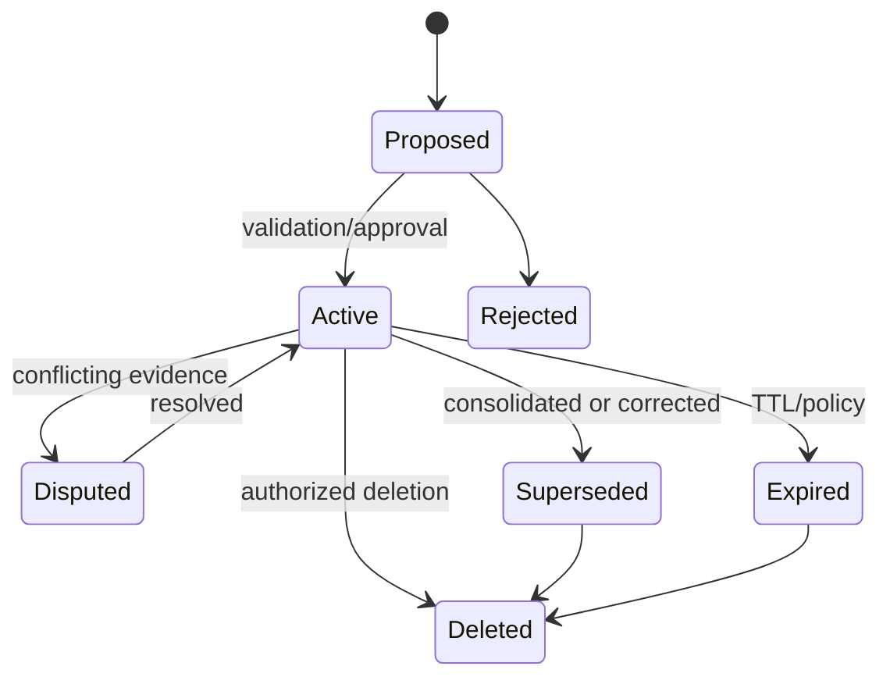

# First-Class Memory Model and Lifecycle

**Parent:** [Blueprint index](../README.md)  
**Capability owners:** CAP-07 / CAP-08  
**Design intent:** Agent-ready memory from the first release, not a later extension.

## Distinct types

| Type | Content | Persistence | Example |
|---|---|---|---|
| `working` | Active task status, temporary plan, latest decisions | Session/run TTL; optionally checkpoint | Comparing offers today |
| `episodic` | Notable experience or interaction | Durable unless policy expires | Conversation about founding a company |
| `semantic` | Consolidated factual/preference proposition | Durable and subject to corrections | Sarah prefers remote work |
| `procedural` | Explicit or learned way of assisting | Versioned, approved if shared | Show a pros/cons comparison before advice |

**`shared` is a scope, not a type.** Visibility dimensions include `workspace`, `subject`, `project`, `agent`, `session`; a memory may carry multiple permitted scopes with scoped ACLs. No automatic permission inheritance simply because scopes nest.

## Curated memory record

- `memory_id`, `workspace_id`, `type`, `content`, `summary`, optional structured `assertion`.
- `subject_ids`, `topic_ids`, `scope_ids`, `visibility_policy_id`.
- `source_event_ids`, `graph_episode_ids`, `related_fact_ids`; `created_by`, `derived_by_model` and `pipeline_version`.
- `occurred_at` (when applicable), `effective_from`, `effective_until`, `recorded_at`, `last_confirmed_at`.
- `status`: `proposed|active|superseded|disputed|expired|rejected|deleted`.
- `importance` (retention heuristic), `confidence` (if calibrated), `authority_class` (policy signal), `sensitivity_class`.
- `embedding`, `embedding_model_id`, `embedding_dimensions`, `embedding_version` (PostgreSQL / pgvector).
- `replaces_memory_ids`, `consolidated_from_memory_ids`, `revision` and `etag`.

Important: importance and confidence are **not truth**. An agent-generated score must never automatically elevate a guess above explicit verified evidence.

## Lifecycle

A memory may be created directly from an explicit, trusted preference or curated from an episode. Procedural memory shared across agents requires stricter publishing authority because it can influence agent behavior.

## Creation modes

- **Explicit:** user/admin instructs system to remember a fact or preference. Store verbatim attribution and clear purpose.
- **Extracted:** model proposes a consequential detail from event content; avoid making permanent memory out of every sentence.
- **Agent finding:** an agent proposes a source-backed result for shared reuse; submit through approval policy.
- **Consolidated:** worker synthesizes related memories, preserves references and does not destroy older evidence without policy.

## Consolidation policy

1. Group by subject, semantic topic, time and permitted scope.
2. Detect exact and semantic duplicates.
3. Compare authority, time and contradictions before merging.
4. Produce an explicit summary **with source IDs**.
5. Supersede redundant memories only after policy approval; keep original event evidence under retention rule.
6. Update embeddings and invalidate retrieval caches; a consolidation job is idempotent.

Do not collapse distinct statements (e.g., dislikes commute vs wants remote employment) into a stronger claim without evidence. Do not turn a temporary consideration into a firm decision.

## Memory selection policy (configurable)

- Importance: explicit user request and consequential decisions likely deserve higher retention.
- Reuse potential: persistent constraints, preferences, ongoing projects and decisions.
- Privacy: sensitive material may be excluded, held in more limited scope, or not stored at all.
- Repetition: duplicates should reinforce evidence only if independent, not produce near-identical context items.
- Aging: old facts may remain valid; apply temporal status and confirmation recency, not blind recency decay.

## Memory/graph overlap decision

A durable semantic fact may be graph-representable. Store the **canonical relationship in Neo4j** and a concise agent-ready memory in PostgreSQL only when it adds recall/meaning (e.g., summarized experience or instruction). Link via IDs; avoid competing unlinked copies of truth. The Context Service reconciles them and prefers source-backed current facts.

## Access and prompt-safety

Memory content is untrusted task data, even when written by another agent. It must not silently override system/developer instructions. Treat procedural memory as policy-controlled user/domain preferences, with hierarchy checks. Scope filters are mandatory for embedding search and any graph lookup.

## Requirements / acceptance

- `MEM-01` Explicit save and extracted memory proposal both create attributable records.
- `MEM-02` Working memory is isolated to the run/agent unless explicitly published.
- `MEM-03` Two agents share approved workspace/project memories but not private working memory.
- `MEM-04` New evidence can supersede an earlier memory without deleting provenance.
- `MEM-05` Search respects status, validity, sensitive labels and authorization.
- `MEM-06` Consolidation reduces redundant memories while preserving distinct claims and source links.
- `MEM-07` User/admin correction and authorized deletion propagate to embeddings, graph references and caches.
