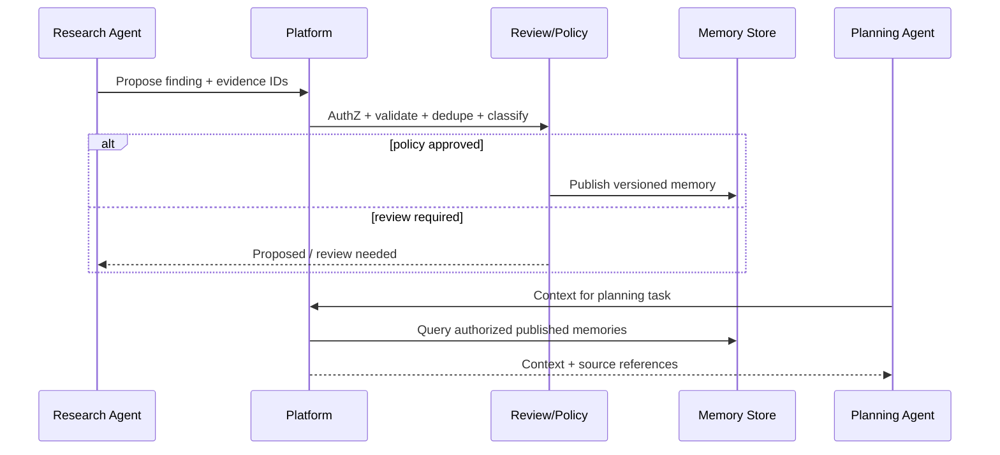

# Multi-Agent Integration and Shared Memory

**Parent:** [Blueprint index](../README.md)  
**Capability owners:** CAP-10 / CAP-11

## Operating model

Agents are **clients** of the platform. The platform does not schedule their tasks or choose their external tools. A Research Agent, Planning Agent and Personal Assistant all call the same read/write services with authenticated identities and their own allowed scopes.

## Agent registration and roles

A registered agent has an immutable ID, workspace membership, owner, allowed subjects/projects, permitted memory scopes, read/write privileges, context profiles, rate/token quotas and model disclosure policy. Execution run and session IDs are separate from long-term agent identity.

## Access patterns

- **Read:** `context/build`, `memories/search`, `entities/get`, `evidence/get` (authorization each time).
- **Write:** `interactions`, `memories/proposals` with source IDs and self-reported evidence/derivation.
- **Publish:** only authorized trusted roles or policy-approved validated findings; proposals are not immediate shared truth.
- **Working state:** agent+run scoped; must not leak by accidental workspace-wide inheritance.

## Publish model

## Shared memory policy

- A workspace-scoped fact is eligible for several agents only after publication and scope authorization.
- Subject-private memory is not exposed merely because an agent works in the same workspace.
- Agents cannot alter higher-priority system policies by proposing a procedural memory.
- The Memory Service can surface a published finding with clear labels `agent_generated` and `verified/unverified`.
- Consumers can request `evidence_required=true` when decisions demand auditability.

## SDK and MCP boundary

Provide a thin typed Python SDK initially (`build_context`, `ingest_interaction`, `propose_memory`, `search_memory`, `get_evidence`), mirroring OpenAPI models. Optionally publish an MCP server wrapper exposing safe tools with the same access checks. MCP is a transport adaptation, **not** a privileged bypass of application API/auth. Future TypeScript SDK can be generated from OpenAPI.

## Context use in prompting

The consuming agent receives context as **quoted or structured data**. The platform explicitly marks provenance and confidence; agents should not treat retrieved web pages, transcripts or other agent notes as new system instructions. Procedural memories represent authorized preferences and must remain subordinate to application/system policies.

## Acceptance

- `AGT-01` Research Agent publishes an approved, source-linked finding that Planning Agent can retrieve.
- `AGT-02` Private Research Agent working notes are excluded from Planning Agent context.
- `AGT-03` Agent cannot set an arbitrary workspace or Graphiti namespace in its request.
- `AGT-04` Proposal referencing nonexistent or unauthorized evidence fails validation.
- `AGT-05` Revoked agent loses read/write access immediately, including prior context links.
