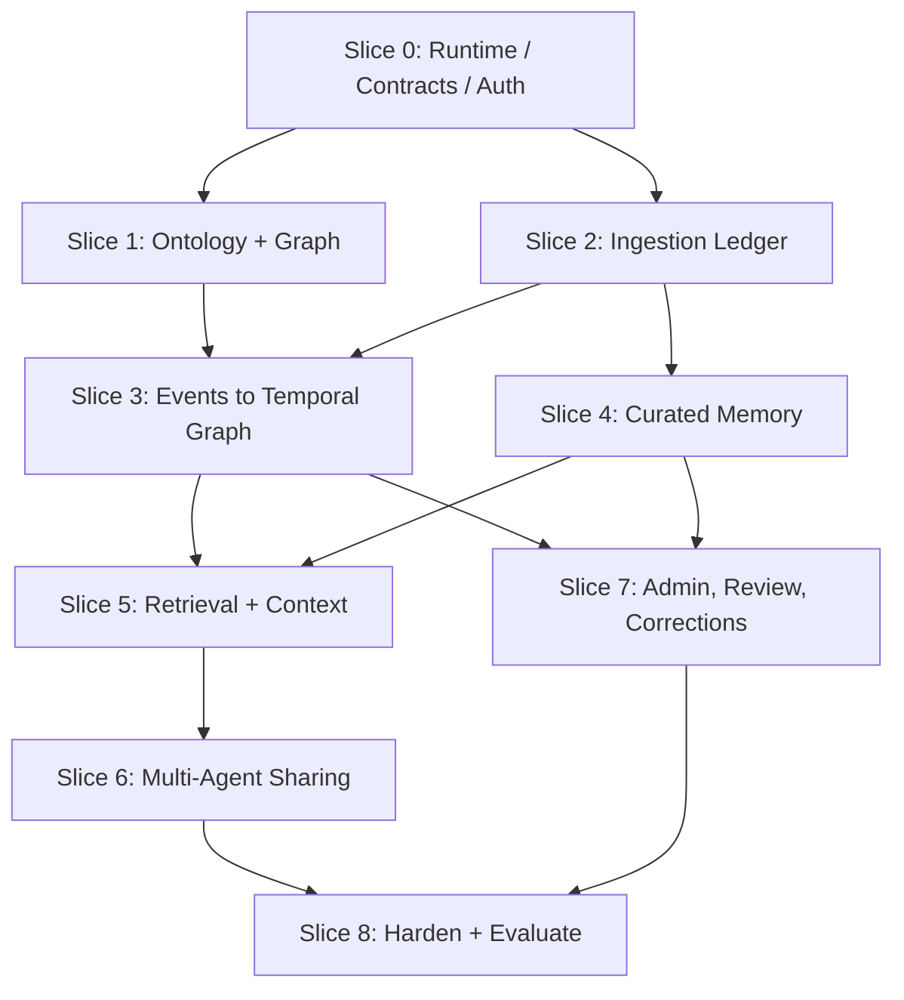

# Implementation Slices: Planning Backbone

**Parent:** [Blueprint index](../README.md)  
**Purpose:** Decompose the solution into narrow, runnable milestones for engineering implementation plans. Each slice includes a complete vertical demonstration and tests. Timing/effort estimates intentionally omitted.

## Dependency order

## Slice 0 — Repository, runtime and security foundation

**Deliver:** Monorepo structure, Docker Compose, pinned compatibility stack, FastAPI health endpoints, Postgres schema migration, Neo4j connection, provider adapter, agent/app identities, workspace middleware, base telemetry, OpenAPI and seed workspace.  
**Demo:** service starts and authorized agent sees its own workspace; another agent cannot.  
**Gate:** repeatable clean start and zero unauthorized cross-workspace reads.

## Slice 1 — Configurable ontology and deterministic object APIs

**Deliver:** draft/publish type registry, config validation and version pinning, Person/Organization sample, typed entity commands, relationship validation, Graphiti custom-type adapter, basic schema Admin.  
**Demo:** admin publishes Person → WORKS_AT → Organization; trusted app creates Sarah and Acme.  
**Gate:** published versions immutable; disallowed relationship rejected; deterministic writes don't use an LLM.

## Slice 2 — Interaction source ledger and outbox

**Deliver:** `POST /interactions`, event envelope, idempotency, outbox dispatcher, statuses, retry/dead-letter and event list/detail Admin.  
**Demo:** ingest a conversation and show one durable accepted event even after same-key retry.  
**Gate:** accepted event not lost on worker crash.

## Slice 3 — Graphiti processing, identity and time

**Deliver:** worker-to-Graphiti adapter, namespace routing, episode/source linkage, entity resolution review, temporal facts, as-of queries and graph inspector.  
**Demo:** Sarah changes role; history and sources remain distinguishable.  
**Gate:** historical/current queries work; two distinct Sarahs not wrongly merged.

## Slice 4 — First-class curated memory

**Deliver:** memory schema, pgvector or exact-search beginning, proposals, explicit saved preferences, episodic summaries, status/TTL, memory Explorer, memory correction and source links.  
**Demo:** Sarah's entrepreneurship conversation creates a source-backed episodic memory and an explicit preference is separately stored.  
**Gate:** scope isolation, status and evidence handling correct.

## Slice 5 — Task-aware context engine

**Deliver:** graph + memory hybrid retrieval, context profiles, filtering, dedup, time reconciliation, deterministic compression, token budgets, citations, `context/build`, Context Lab and traces.  
**Demo:** planning question yields short current state, relevant aspiration memory, important unknown, source references.  
**Gate:** 600 token ceiling; relevant content recovered, unrelated memory excluded, no stale or unauthorized data.

## Slice 6 — Shared multi-agent memory

**Deliver:** agent registration/scopes, proposals/reviews, working vs shared scope, SDK, optional MCP shim, cross-agent read/write tests.  
**Demo:** Research Agent publishes approved finding; Planning Agent retrieves it; private scratchpad remains hidden.  
**Gate:** source validation, sharing policy and revocation tests pass.

## Slice 7 — Governance and operational admin

**Deliver:** correction workflows, relationship expiry, identity merge/split review, ontology simulation, memory consolidation, deletion orchestration, job repair screens and privacy audit.  
**Demo:** reviewer corrects invalid claim and deletion removes it from context immediately.  
**Gate:** correction propagates to graph, memory, embeddings and traces/caches as applicable.

## Slice 8 — Evaluation, recoverability and release hardening

**Deliver:** seeded regression/evaluation suite, leakage tests, failover and replay tests, backup restore rehearsal, query cost/performance baselines, threat review, runbooks and release checklist.  
**Demo:** full Sarah walkthrough through two agents, including model/provider outage and correction.  
**Gate:** all release acceptance tests pass, and unresolved production decisions are documented.

## Prompt template for planning each slice

> Produce an implementation plan for **Slice N** using this blueprint and its linked domain/runtime specs. Include repository layout, file-level work items, Pydantic/SQL schemas and migrations, adapter interfaces, HTTP OpenAPI contracts, authorization points, worker states and idempotency, UI routes/components if applicable, test fixtures, negative tests, telemetry, deployment/configuration, data backfill/replay, risks, and verifiable acceptance demos. Distinguish implemented functionality from placeholders and state any dependency/version assumptions.

## Scope control

Do not build a complex custom rules language, agent orchestration framework, separate vector database, Kafka cluster, graph visualization engine from scratch, or new retrieval models until tests justify them. The first objective is a trustworthy vertical slice delivering concise context to two agents.
