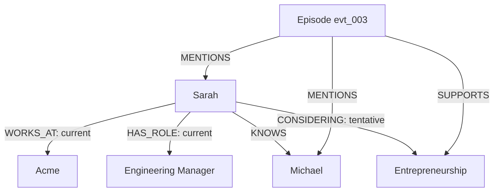

# Worked Example: Sarah, Her Relationships, Memories and Two Agents

**Parent:** [Blueprint index](../README.md)  
**Purpose:** Concrete test fixture for an implementation planner, not a claim about a real person.

## Actors and entities

- Person: `person_sarah` — Sarah Johnson.
- Person: `person_michael` — Michael Chen, colleague and friend.
- Organization: `org_acme` — Acme.
- Topic: `topic_entrepreneurship` — entrepreneurship.
- Agent: `agent_research` — sources relevant findings.
- Agent: `agent_planning` — advises on the business decision.

## Source event timeline

| ID | Occurred | Recorded | Event | Trust |
|---|---|---|---|---|
| `evt_001` | 2022-01-10 | 2022-01-10 | Acme records Sarah joined as Software Engineer | Authoritative HR-like fixture |
| `evt_002` | 2024-06-01 | 2024-06-10 | Acme records Sarah became Engineering Manager | Authoritative, backdated |
| `evt_003` | 2026-10-10 | 2026-10-11 | Sarah told Michael she is considering starting a software company | Conversation: evidence of statement, not decision |
| `evt_004` | 2026-10-12 | 2026-10-12 | Sarah explicitly prefers comparisons showing risks and tradeoffs | Direct asserted preference |
| `evt_005` | 2026-10-13 | 2026-10-13 | Research Agent submits sourced analysis about the planned industry | Agent candidate requiring validation |
| `evt_006` | 2027-02-01 | 2027-02-05 | Acme records Sarah's employment end date | Authoritative, historical update |

Dates after document date represent **future fixture steps**, not present facts.

## Graph projection at October 11, 2026



The statement about entrepreneurship is a **claim with source provenance**; it does not invalidate `WORKS_AT Acme`.

## Curated memory proposal

```json
{
  "memory_id": "mem_003",
  "workspace_id": "demo",
  "type": "episodic",
  "subject_ids": ["person_sarah"],
  "scope": {"kind": "subject", "id": "person_sarah"},
  "status": "active",
  "content": "Sarah discussed a possible software business with Michael; she had not decided to leave Acme.",
  "source_event_ids": ["evt_003"],
  "occurred_at": "2026-10-10T19:00:00Z",
  "authority_class": "conversation_report"
}
```

A separate semantic memory may record an explicitly declared preference in `evt_004`. That preference can become eligible for both agents if the subject/workspace sharing policy permits it.

## Agent A: Research

Task: investigate possible market/regulatory constraints. Research Agent reads authorized knowledge about Sarah's intended business, performs external work outside this platform, then calls `/v1/memories/proposals` with a concise, sourced finding. Publication policy verifies citations and scope before the memory becomes visible to others. This finding **does not automatically become confirmed personal belief of Sarah**.

## Agent B: Planning

Task: advise Sarah whether to explore starting a business. It calls `/v1/context/build` with subject `person_sarah`, profile `planning`, budget 600 tokens. Expected:

- Current verified employer/role (as of 2026-10-11).
- Episodic memory about discussion with Michael and uncertainty about resignation.
- Authorized procedural preference for comparisons (if `evt_004` is already ingested at requested `known_at`).
- Research finding if published and in temporal/query scope.
- Unknown: Sarah's finances/runway unless independently provided.
- Exclusion: unrelated interactions and other agents' private working notes.
- Evidence references to `evt_001` / `evt_002` / `evt_003` etc., with proper date filtering.

## Later change: 2027

A future authoritative record states Sarah left Acme effective 2027-02-01. The platform marks the older employment relationship historically valid through that date, captures that the system learned it on February 5, and returns different current/historical answers depending on `as_of` and `known_at`. Her entrepreneurship memory remains a historical experience; it is not rewritten as if she always intended resignation.

## Correcting mistaken extraction

Imagine the model incorrectly claims Michael is Sarah's manager. Reviewer inspects episode evidence, marks the claim rejected, triggers projection correction and cache invalidation. A subsequent context build cannot present that relation as verified. The erroneous original episode remains retained according to source policy.

## Negative access test

Agent from workspace `other_demo` requests `person_sarah` context. Authorization fails before any graph/vector retrieval; no names, counts, or candidate IDs appear in response or trace. This is a release-blocking test.

## Acceptance summary

This scenario is complete only when memory is retrieved by a different agent with provenance and a hard token budget; source/graph/memory states distinguish current and historical; corrections propagate; workspace/agent isolation holds; and idempotent processing tolerates retries.
